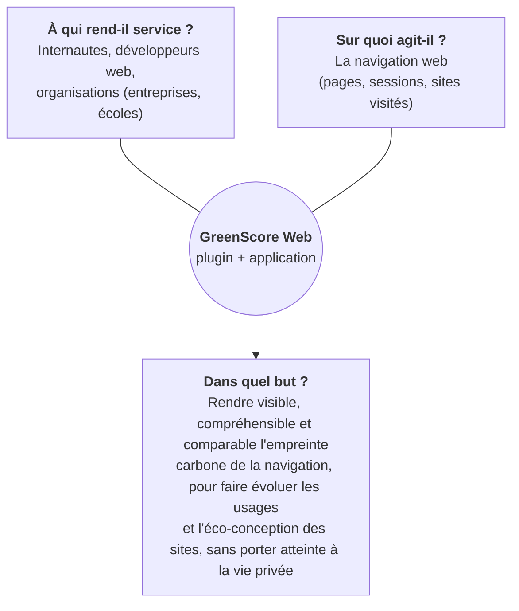
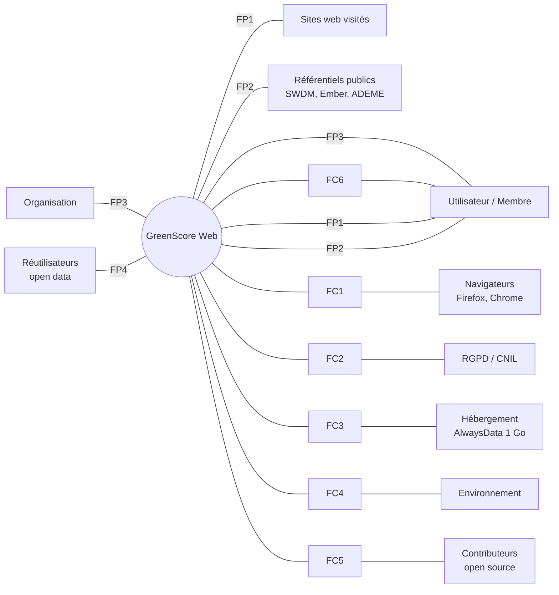
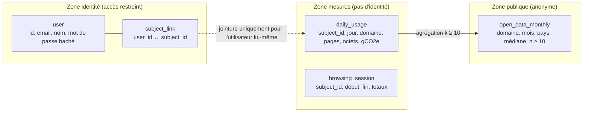
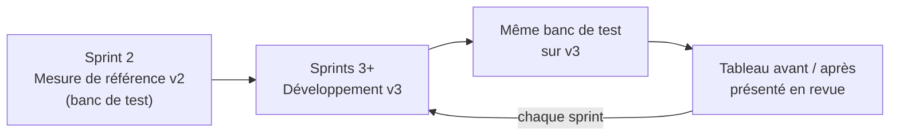

# GreenScore Web — Cahier des charges fonctionnel (analyse du besoin)

**Mesurez l'impact de votre activité sur le web**

| | |
|---|---|
| **Version** | 3.0 (projet) — vendredi 16 octobre 2026 |
| **Groupe** | N°2 — PIETRERA-FERRANDINI Jeanne, PINSOLLE Romain, RIOUX Baptiste, ROCHE--RODRIGUEZ Killian |
| **Commanditaire** | Philippe ROOSE |
| **Encadrement** | Philippe ROOSE, Robin CONCHEZ, Estéban DESESSARD |
| **Cadre** | BUT Informatique 3ᵉ année — SAÉ S5.01 & S6.01 — IUT de Bayonne et du Pays Basque — 2026-2027 |
| **Documents liés** | [Cahier des charges technique (CDCT)](CDCT.md) · [Méthodologie de calcul](methodologie-calcul.md) · [Décisions d'architecture (ADR)](adr/) |

---

## Suivi des versions

| Version | Date | Auteurs | Modifications |
|---|---|---|---|
| 1.0 | 09/10/2026 | Équipe | Première version des éléments d'analyse du besoin |
| 2.0 | 16/10/2026 | Équipe | Historique, existant, MoSCoW, personae, cas d'utilisation, BPMN, calendrier |
| 3.0 | 16/10/2026 | Équipe (voir avant-propos) | Suite aux retours des encadrants : **objectifs mesurables avec situation de référence et cibles** (§1.4), **limites chiffrées de l'existant** (§3.3), **analyse concurrentielle** (§3.4), **analyse fonctionnelle APTE** (bête à cornes, pieuvre, fonctions caractérisées, §4), **critères d'acceptation** (§5), **exigences non fonctionnelles mesurables** (§6), **données personnelles et anonymisation** (§7), **dimensionnement du stockage (1 Go)** (§8), **stratégie de preuve** (§9), **réponses aux questions des encadrants** (§10), **risques** (§11). La partie technique est déplacée dans le [CDCT](CDCT.md). |

## Avant-propos : usage de l'IA générative

> ⚠️ **À relire et valider par toute l'équipe avant remise.** Le texte de la v2 (« reformulation, correction, mise en forme uniquement ») **ne correspond plus** à la façon dont la v3 a été produite. Il doit être remplacé par une déclaration exacte, par exemple :

Conformément aux consignes de la SAÉ, nous précisons l'usage que l'équipe a fait d'outils d'IA générative pour produire ce document. Cet usage concerne la documentation, et non le produit GreenScore Web.

- **Outils :** Claude Sonnet 5.5 et Gemini 3.8 (v1, v2 : reformulation, correction, mise en forme) ; **Claude Opus 5.5 via Claude Code** (v3).
- **Usage pour la v3 :** à partir de notre v2 et des retours des encadrants, l'outil a **analysé le code public de l'équipe 2025-2026** et **proposé une première rédaction** des parties nouvelles : objectifs mesurables, limites de l'existant, analyse fonctionnelle, critères d'acceptation, anonymisation, dimensionnement, stratégie de preuve, cahier des charges technique et méthodologie de calcul.
- **Notre rôle :** relire, vérifier les constats dans le code et les sources, corriger, arbitrer les choix (voir les points « à arbitrer ») et assumer le contenu final. Chaque constat sur le code est référencé (fichier, fonction) pour pouvoir être vérifié.

---

## Sommaire

1. [Présentation du projet](#1-présentation-du-projet)
2. [Organisation et gestion de projet](#2-organisation-et-gestion-de-projet)
3. [Analyse de l'existant](#3-analyse-de-lexistant)
4. [Analyse fonctionnelle du besoin](#4-analyse-fonctionnelle-du-besoin-méthode-apte)
5. [Exigences fonctionnelles](#5-exigences-fonctionnelles)
6. [Exigences non fonctionnelles](#6-exigences-non-fonctionnelles-mesurables)
7. [Données personnelles et anonymisation](#7-données-personnelles-et-anonymisation)
8. [Dimensionnement : le 1 Go suffit-il ?](#8-dimensionnement--le-1-go-suffit-il-)
9. [Stratégie de preuve](#9-stratégie-de-preuve--comment-nous-démontrerons-les-améliorations)
10. [Réponses aux questions des encadrants](#10-réponses-aux-questions-des-encadrants)
11. [Risques](#11-risques)
12. [Calendrier prévisionnel](#12-calendrier-prévisionnel)
13. [Glossaire](#13-glossaire)
14. [Annexes et sources](#14-annexes-et-sources)

---

## 1. Présentation du projet

### 1.1 Contexte

L'usage du numérique a explosé dans tous les domaines (professionnel, domestique, ludique). Cette transformation a un coût environnemental : fabrication des terminaux, consommation des réseaux et des centres de données.

D'après l'**ADEME et l'Arcep** (*Évaluation de l'impact environnemental du numérique en France*, mise à jour publiée en janvier 2025, données 2022), le numérique représente **4,4 % de l'empreinte carbone de la France**, contre 2,5 % dans l'estimation précédente (données 2020). L'étude rappelle que l'essentiel de l'impact vient de la **fabrication des équipements**. Un outil sérieux doit donc tenir compte de cette part « fabrication », et pas seulement de l'électricité consommée. C'est l'un des défauts de l'outil actuel (§3.3).

Le cadre réglementaire pousse dans le même sens :
- la **loi REEN** (2021) vise à réduire l'empreinte environnementale du numérique en France ;
- le **RGESN** (Référentiel général d'écoconception de services numériques, Arcep/Arcom/ADEME/DINUM) fixe des critères d'éco-conception.

Mesurer, visualiser et comparer l'impact de la navigation répond à ce besoin de sensibilisation et d'aide à l'éco-conception.

### 1.2 Le produit GreenScore Web

GreenScore Web comporte deux éléments :

1. un **plugin de navigateur** (Firefox, Chrome) qui estime en arrière-plan l'empreinte carbone des pages visitées et la vulgarise : note, équivalents concrets (km en voiture, recharges de smartphone, etc.) ;
2. une **application web** où l'utilisateur crée un compte pour suivre sa consommation dans le temps. Une organisation peut y suivre la consommation agrégée de ses membres.

Le projet en est à sa **troisième année**. Il a été initié en 2024-2025 (plugin Firefox, application PHP Symfony), puis refondu techniquement en 2025-2026 (API Rust, front-end SvelteKit, MySQL, hébergement AlwaysData). Notre équipe le reprend en 2026-2027.

### 1.3 Problématique : pourquoi reprendre GreenScore ?

L'audit du code public de l'équipe 2025-2026 (détaillé dans le [CDCT §2](CDCT.md#2-audit-technique-de-lexistant) et la [méthodologie §2](methodologie-calcul.md#2-le-modèle-hérité-v2-équipes-2024-2025-et-2025-2026)) montre que **les fonctionnalités existent, mais que l'on ne peut pas faire confiance aux chiffres affichés** :

| # | Constat (vérifiable dans le code) | Conséquence pour l'utilisateur |
|---|---|---|
| C1 | Le nombre de requêtes compte pour **96 %** du résultat ; diviser le poids d'une page par 10 ne change le score que de **3,4 %** | Un développeur qui optimise ses images ne voit **aucun progrès** |
| C2 | Sur **Chrome**, le volume transféré vaut **toujours 0** (propriété d'API inexistante) | Une même page a deux scores selon le navigateur |
| C3 | L'intensité carbone dépend de l'état d'une API externe : la **même page** donne 0,62 g, 5,51 g, ou **une valeur négative** | Résultats non reproductibles, parfois absurdes |
| C4 | La note A à G est présentée comme « norme EcoIndex », mais elle utilise des **seuils fixes non sourcés** (0,25 g) | Information trompeuse |
| C5 | La note du profil est calculée sur des **totaux cumulés** avec une formule incohérente (un utilisateur exactement « moyen » peut obtenir E) | Classement injuste, décourageant |
| C6 | L'**URL complète** de chaque page visitée est stockée, avec l'identifiant de l'utilisateur ; l'adresse IP est envoyée à un service tiers de géolocalisation | Atteinte à la vie privée (historique de navigation identifiant) |
| C7 | L'API enregistre une mesure pour **n'importe quel `user_id` envoyé par le client**, avant de vérifier la session | N'importe qui peut fausser les données d'un autre compte |
| C8 | Une clé d'API et un export de base contenant des comptes (e-mails, mots de passe hachés) sont **publiés dans le dépôt public** | Publication open source impossible en l'état |
| C9 | Une ligne est stockée **par page vue** (souvent deux à cause d'un envoi en double) | Le stockage de 1 Go serait saturé avec quelques dizaines d'utilisateurs actifs (§8) |

**Problématique :** *comment transformer GreenScore Web en un outil dont les chiffres sont fiables, vérifiables et comparables, qui respecte la vie privée de ses utilisateurs et tient dans les ressources d'un hébergement sobre, tout en ajoutant l'analyse de sessions multipages ?*

### 1.4 Objectifs mesurables

Chaque objectif a une **situation de référence** (mesurée sur la version 2025-2026, appelée « v2 ») et une **cible** (version 2026-2027, appelée « v3 »). La colonne « Preuve » indique comment l'atteinte sera démontrée (détail au §9 et au [CDCT §12](CDCT.md#12-protocole-de-validation-de-la-précision)).

| ID | Objectif | Indicateur | Référence v2 | Cible v3 | Preuve |
|---|---|---|---|---|---|
| **O1** | Mesurer correctement le volume transféré | Écart relatif entre les octets mesurés par le plugin et les octets du moniteur réseau du navigateur (export HAR), sur un corpus de 30 pages | Firefox : sous-estimé (division ÷3 à ÷5) ; Chrome : 100 % d'erreur (toujours 0). *Valeurs exactes mesurées au Sprint 2* | Médiane **< 5 %**, 90ᵉ centile **< 15 %** | Banc de test reproductible (script + corpus publiés) |
| **O2** | Résultats identiques sur Firefox et Chrome | Écart Firefox/Chrome sur le même corpus | Non comparable (Chrome = 0) | **< 10 %** | Même banc de test, deux navigateurs |
| **O3** | Résultats reproductibles | Coefficient de variation sur 5 mesures d'une même page | Dépend de l'API live (jusqu'à ×9, voire négatif) | **< 10 %** | 5 passages automatisés par page |
| **O4** | Conformité à un modèle public | Écart entre notre calcul et la bibliothèque de référence CO2.js sur les vecteurs de test | Sans objet (modèle non sourcé) | **0** (tolérance 10⁻⁹) | Tests automatisés en intégration continue |
| **O5** | Note utile pour l'éco-conception | Variation du score quand le poids de la page est divisé par 10 | −3,4 % | **−90 %** (proportionnel) | Test sur page de démonstration « avant / après » |
| **O6** | Ne plus stocker l'historique de navigation identifiant | Nombre de champs identifiants ou URL complètes dans les tables de mesures | `url_full` + `user_id` sur chaque ligne | **0** URL complète ; mesures **pseudonymisées** ; données ouvertes **k-anonymes (k ≥ 10)** | Revue du schéma + test automatique sur l'export |
| **O7** | Tenir dans 1 Go | Octets stockés par utilisateur actif et par an | ≈ 22 Mo (estimation §8) | **≤ 1 Mo** (×20 de moins) | Mesure `information_schema` sur un jeu de données simulé, puis en production |
| **O8** | Plugin sobre | Requêtes réseau émises par le plugin pour 100 pages vues | ≈ 200 (envoi par page, souvent en double) + appels de géolocalisation et d'intensité | **≤ 10** (envoi groupé) et **0** appel tiers | Compteur interne + moniteur réseau |
| **O9** | Sécurité minimale avant ouverture du code | Secrets dans le dépôt / failles d'autorisation connues | 1 clé d'API + 1 export de comptes ; 1 faille d'autorisation (C7) | **0** (vérifié par un outil de détection de secrets en CI) | Rapport de l'outil de détection en CI |
| **O10** | Analyse de sessions multipages | Fonctionnalité livrée et recettée | Absente | Critères d'acceptation EF-SES 1 à 6 validés | Recette avec le commanditaire |

> **Méthode de travail « preuve d'abord » :** la **première tâche du Sprint 2** sera de mesurer la v2 avec le banc de test. Sans cette mesure de référence, aucune amélioration ne peut être démontrée. Les valeurs « *mesurées au Sprint 2* » ci-dessus seront alors remplacées par des valeurs réelles dans la v4 de ce document.

### 1.5 Périmètre

| Dans le périmètre (2026-2027) | Hors périmètre |
|---|---|
| Plugin Firefox et Chrome (une seule base de code) | Safari, navigateurs mobiles |
| Analyse de sessions multipages | Analyse côté serveur d'un site (audit d'URL à distance) |
| Nouveau modèle de calcul sourcé, transparent, versionné | Bilan carbone réglementaire (BEGES, ACV complète) |
| Pseudonymisation, minimisation, données ouvertes anonymisées | Monétisation, offre commerciale |
| Export personnel (JSON/CSV) et open data | Intelligence artificielle (Won't, à réévaluer en S6) |
| Publication open source (code, documentation FR/EN) | Changement d'hébergeur (sauf si le dimensionnement l'impose, ADR) |

---

## 2. Organisation et gestion de projet

### 2.1 Méthodologie

Nous sommes tous en alternance, avec le même rythme : périodes à l'IUT (le projet avance) et périodes en entreprise (le projet avance peu). Nous appliquons un **cycle de vie hybride** :
- une phase **linéaire de cadrage** : analyse du besoin, audit de l'existant, cahiers des charges, mesure de référence ;
- puis une phase **itérative** : un **sprint Scrum par période à l'IUT**, avec un point d'étape avec le commanditaire, et un **board Kanban** tenu à jour en continu.

### 2.2 Outils

| Besoin | Outil |
|---|---|
| Backlog, suivi des tâches | Plane auto-hébergé (https://plane.romain-pinsolle.fr/) : références uniques (ex. `PROJETGREE-14`), responsable, dates, état |
| Code, revue, intégration continue | GitHub — dépôt de l'équipe : https://github.com/Kall0n/Greenscore |
| Documents | Le dépôt (`docs/`, en Markdown versionné) pour les livrables ; le Google Drive de l'équipe pour les documents de travail |
| Décisions d'architecture | ADR dans `docs/adr/` |

### 2.3 Rituels

- **Lancement de sprint :** sélection des tâches du backlog selon la priorisation MoSCoW, puis répartition.
- **Daily meeting** (≈ 5 min) pendant les sprints : fait / à faire / blocages.
- **Revue de sprint** avec Philippe ROOSE : démonstration et **présentation des indicateurs O1 à O10** (§1.4), qui montrent l'avancement mesuré, et pas seulement les fonctionnalités livrées.
- **Rétrospective** après chaque revue.

### 2.4 Définition de « terminé » (Definition of Done)

Une tâche est terminée quand :
1. le code est relu par au moins un autre membre (*pull request* approuvée) ;
2. les tests automatisés passent en CI, avec des tests nouveaux si la tâche touche au calcul ou aux données ;
3. les critères d'acceptation de l'exigence sont vérifiés ;
4. la documentation (FR, puis EN) est à jour ;
5. aucun secret n'est détecté dans le code ;
6. si un indicateur O1 à O10 est concerné, sa nouvelle valeur est mesurée et notée.

### 2.5 Calendrier de l'alternance

La formation débute le 21 septembre 2026 et comprend 560 heures de présence à l'IUT, réparties en périodes qui alternent avec l'entreprise. La soutenance de fin d'année a lieu fin août 2027. Chaque période à l'IUT correspond à un sprint ; les périodes en entreprise servent au suivi asynchrone du board et à la préparation de la revue suivante.

### 2.6 Rôles

| Membre | Rôle principal | Répartition indicative |
|---|---|---|
| PIETRERA-FERRANDINI Jeanne | Développeuse | 100 % développement |
| PINSOLLE Romain | Scrum Master | 30 % SM, 70 % développement — le plus expérimenté en agilité (son équipe en entreprise l'applique au quotidien) |
| RIOUX Baptiste | Développeur | 100 % développement |
| ROCHE--RODRIGUEZ Killian | Proxy Product Owner | 20 % PPO, 80 % développement — meilleure relation avec le commanditaire, bonnes compétences en communication |

**Référents techniques proposés** (à valider par l'équipe) : un référent par domaine sensible, chargé de la relecture des PR de ce domaine. Domaines : modèle de calcul et banc de test ; plugin ; API et données (dont la pseudonymisation) ; infrastructure et CI (Romain, compétences infrastructure et réseaux).

### 2.7 Points forts et points faibles de l'équipe

| | Points forts | Points de vigilance | Action |
|---|---|---|---|
| Équipe | Autonomie, efficacité | Communication interne et externe | Daily systématique, compte rendu écrit de chaque revue, PR obligatoires (le partage passe par la revue de code) |
| Jeanne | À l'écoute, calme | Autonomie | Binômage sur les premières tâches |
| Romain | Infrastructure et réseaux, calme | Réserve à l'oral | Présente la partie infra et CI aux revues |
| Baptiste | Réactif, autonome | Arrivée récente (initiation à l'agile) | Accompagnement par le Scrum Master |
| Killian | Autonome, discret | Tendance à travailler seul, communication | Rôle de PPO : synthèse écrite après chaque échange avec le commanditaire |

---

## 3. Analyse de l'existant

### 3.1 Historique

| Année | Équipe | Principales réalisations |
|---|---|---|
| 2024-2025 | Équipe-projet 2024-2025 (contact : Néo ELDUAYEN) | Première version : plugin Firefox fonctionnel, application web PHP Symfony, tableaux de bord utilisateur et organisation, premier cahier des charges |
| 2025-2026 | Groupe 8 : Théo BIREMBAUX, Robin CONCHEZ-BOUEYTOU, Estéban DESESSARD, Mathis RIVRAIS-NOWAKOWSKI | Refonte : back-end Rust, front-end SvelteKit, hébergement AlwaysData, nouveau dépôt, sessions en base, tableau de bord organisation, version Chrome du plugin |
| 2026-2027 | Notre équipe | **Conservé :** architecture (Rust / SvelteKit / MySQL / AlwaysData), choisie pour sa sobriété. **Amélioré :** modèle de calcul, structure des données, sécurité, vie privée. **Créé :** sessions multipages, export, open data, publication open source |

### 3.2 Fonctionnalités existantes

*(Les captures d'écran et les tableaux détaillés des Figures 3 à 8 de la v2 sont repris dans la version mise en page.)*

| Tableau de bord | Fonctionnalité | Réalisée | Fiabilité constatée (audit) |
|---|---|---|---|
| Page consultée | Lettre de A à G | Oui | ⚠️ Seuils fixes non sourcés ; ce n'est pas l'EcoIndex (C4) |
| | Empreinte carbone de la page | Oui | ❌ Modèle non sourcé, dominé par les requêtes, faux sur Chrome (C1-C3) |
| | Équivalents vulgarisés | Oui | ⚠️ Facteurs non sourcés (moto = voiture) |
| | Taille de la page, nombre de requêtes, temps de chargement | Oui | ⚠️ Taille sous-estimée (Firefox) ou nulle (Chrome) |
| | Pays de l'utilisateur et intensité carbone | Oui | ⚠️ Géolocalisation IP par un service tiers (C6) |
| | Conseils d'amélioration, badge d'impact | Oui | ✅ |
| Ensemble des pages visitées | Empreinte depuis l'inscription, équivalents, top 5 des sites | Oui | ⚠️ Totaux faussés par le double envoi (C9) |
| | Diagramme jour / mois / année | Oui | ⚠️ La « moyenne journalière » est en réalité une moyenne **par page** |
| | Comparaison avec un utilisateur moyen | Oui | ❌ Formule incohérente (C5) |
| Organisation | Empreinte totale, top 5, badge | Oui | ⚠️ Dépend de la fiabilité des mesures |
| | Empreinte moyenne d'un membre, diagramme | Partiel | ❌ Mélange sommes et moyennes (C5) |

**Conclusion :** l'existant est **fonctionnellement riche** (ce que nous conservons), mais la **fiabilité des chiffres** doit être reconstruite. C'est le premier objectif de notre année.

### 3.3 Limites constatées de l'existant

Les constats C1 à C9 (§1.3) sont détaillés dans le [CDCT §2.3](CDCT.md#23-constats-détaillés), avec fichier, gravité et correctif. Les questions des encadrants trouvent leur réponse dans ces constats :

- **« Comment prouver que ce sera plus précis ? »** → l'existant n'a **aucune mesure de référence** ni aucun test qui compare ses résultats à une vérité terrain. Nous en créons une (O1-O5, §9).
- **« Comment allez-vous anonymiser ? »** → l'existant stocke l'URL complète liée au compte. Hacher l'identifiant, comme le prévoyait la v2, ne suffit pas : c'est une **pseudonymisation**, pas une anonymisation (§7).
- **« Un seul Go, ça va suffire ? »** → pas avec le modèle de données actuel. Oui avec le modèle agrégé proposé (§8).

### 3.4 Analyse concurrentielle

| Outil | Type | Ce qui est mesuré | Modèle | Sessions / historique | Comptes, organisations | Données personnelles | Ouvert |
|---|---|---|---|---|---|---|---|
| **GreenIT-Analysis** | Extension (outils de développement) | Une page à la demande | EcoIndex + bonnes pratiques | Non | Non | Local | Open source |
| **EcoIndex.fr** | Service web | Une URL, analysée par leur serveur | EcoIndex (A-G) | Historique par URL | Non | Aucune (URL publique) | Algorithme CC BY-NC-ND |
| **Website Carbon Calculator** | Service web | Une URL, analysée par leur serveur | SWDM | Non | Non | Aucune | Méthode publique |
| **Carbonalyser** (The Shift Project) | Extension | Toute la navigation (volume de données) | Modèle « 1byte » du Shift Project | Oui, local | Non | Local | Open source |
| **GreenScore v2** (existant) | Extension + application web | Toute la navigation | Modèle maison non sourcé | Historique cumulé | **Oui** | ❌ URL complètes sur le serveur | Code public sans licence |
| **GreenScore v3** (cible) | Extension + application web | Toute la navigation **et sessions multipages** | **SWDM v4** (CO2.js), versionné | **Sessions, historique, comparaison avant/après** | **Oui** | **Pseudonymisé, minimisé, k-anonyme en open data** | **Open source + open data** |

**Positionnement.** Aucun outil étudié ne combine à la fois :
1. une mesure **de la navigation réelle** (et non d'une URL isolée analysée par un robot) ;
2. des **sessions multipages** comparables dans le temps ;
3. une **dimension collective** (organisations) ;
4. des **données ouvertes** sur l'impact des sites réellement visités.

C'est la valeur ajoutée de GreenScore. Elle n'a de sens que si les chiffres sont fiables. D'où la priorité donnée à la précision et à la vie privée.

*(La veille détaillée de l'équipe 2024-2025 est disponible sur son Google Drive, annexe 14.1.)*

---

## 4. Analyse fonctionnelle du besoin (méthode APTE)

### 4.1 Bête à cornes



### 4.2 Validation du besoin

| Question | Réponse |
|---|---|
| **Pourquoi le besoin existe-t-il ?** | L'impact du numérique est invisible pour l'utilisateur. Sa part augmente (4,4 % de l'empreinte de la France) et la réglementation pousse à l'éco-conception (REEN, RGESN). |
| **Qu'est-ce qui pourrait le faire évoluer ?** | Un affichage environnemental obligatoire des services numériques, l'évolution des modèles d'estimation (d'où le versionnement du modèle), l'arrivée de l'IA générative dans la navigation. |
| **Qu'est-ce qui pourrait le faire disparaître ?** | Des navigateurs intégrant nativement une mesure d'impact fiable, ou une perte de confiance dans l'outil (chiffres faux, fuite de données). Ce second risque est **celui que la v3 traite en priorité**. |
| **Conclusion** | Le besoin est **stable** et **validé**, à condition que l'outil soit **crédible**. |

### 4.3 Parties prenantes et acteurs

| Partie prenante | Intérêt | Attente principale |
|---|---|---|
| **Utilisateur** (sans compte) | Comprendre l'impact d'une page ou d'une session | Simplicité, chiffres compréhensibles |
| **Membre** (avec compte) | Suivre et réduire son impact dans le temps | Historique, comparaison, export |
| **Organisation** | Piloter et valoriser une démarche collective | Agrégats fiables, rapports, respect des salariés |
| **Commanditaire** (P. ROOSE) | Outil pédagogique, crédible, publiable en open source | Rigueur, open source, sobriété |
| **Contributeurs open source** | Comprendre et améliorer le code | Documentation FR/EN, code propre, tests |
| **Réutilisateurs de l'open data** | Étudier l'impact des sites | Données agrégées, documentées, anonymes |
| **Autorités** (RGPD, CNIL) | Protection des données | Minimisation, information, droits |
| **Hébergeur** (AlwaysData) | Respect des conditions de l'offre | ≤ 1 Go, pas d'usage lucratif sur l'offre gratuite |
| **Éditeurs de sites mesurés** | Être évalués de façon juste | Méthode publique, reproductible |

### 4.4 Personae

Les fiches complètes (Figures 15 à 17 de la v2) sont reprises dans la version mise en page. En résumé :

| Persona | Acteur | Profil | Besoin clé | Exigences qui y répondent |
|---|---|---|---|---|
| **Patricia Renoir** | Utilisateur | Enseignante, faible niveau en informatique ; veut des résultats simples et un support pédagogique | Comprendre en un coup d'œil ; montrer en classe l'impact d'une recherche documentaire | EF-PAG-1, EF-SES-1 à 3, EF-ODA-2, ENF-ACC |
| **Esteban Roche** | Membre | Développeur web en agence ; utilise le plugin après chaque optimisation | **Chiffrer les gains réels** de ses optimisations ; comparer avant / après | EF-PRE-1 à 5, EF-SES-4 et 5, EF-EXP-1 |
| **Louis Vignac** | Organisation | Dirigeant de PME (site e-commerce), peu de temps, faible niveau technique | Chiffres **fiables** pour communiquer ; suivre son équipe **sans la surveiller** | EF-ORG-1 à 3, EF-EXP-1, ENF-VIE-4 |

**Ce que les personae imposent au cahier des charges :**
- **Esteban** n'est pas satisfait par le modèle v2 : diviser le poids de ses pages par 10 ne fait gagner que 3,4 % (C1). → La précision et la reproductibilité sont **vitales** (Must).
- **Louis** présentera ces chiffres à des clients. → Il faut une méthode **publique et vérifiable** (EF-PRE-4). → Il ne doit pas pouvoir voir les sites visités par un salarié (EF-ORG-2).
- **Patricia** utilise l'outil en classe, parfois sur des postes partagés. → Il faut pouvoir **utiliser les sessions sans compte** (EF-SES-1).

### 4.5 Diagramme pieuvre (milieux extérieurs)



### 4.6 Fonctions de service

**Fonctions principales (FP) : relient deux milieux extérieurs par l'intermédiaire du produit**

| ID | Fonction |
|---|---|
| **FP1** | Permettre à l'utilisateur de connaître l'empreinte carbone des **pages et sessions** qu'il visite sur les sites web |
| **FP2** | Permettre à l'utilisateur de **comprendre et vérifier** cette empreinte à l'aide de référentiels publics (méthode, équivalents, conseils) |
| **FP3** | Permettre à une organisation de **suivre l'empreinte agrégée** de ses membres sans accéder à leur navigation individuelle |
| **FP4** | Permettre aux réutilisateurs d'accéder à des **données ouvertes anonymisées** sur l'impact des sites |

**Fonctions contraintes (FC) : relient le produit à un milieu extérieur**

| ID | Fonction |
|---|---|
| **FC1** | Fonctionner de manière **identique sur Firefox et Chrome** |
| **FC2** | Respecter le **RGPD** : minimisation, information, droits des personnes |
| **FC3** | Tenir dans les ressources de l'**hébergement** : 1 Go de disque (base comprise), 256 Mo de RAM, 1/4 de processeur |
| **FC4** | Avoir un **impact environnemental propre** minimal (sobriété du plugin et du serveur) |
| **FC5** | Être **publiable en open source** : licence, absence de secrets, documentation FR/EN |
| **FC6** | Être **accessible et compréhensible** par un public non technique |
| **FC7** | Être **sécurisé** : intégrité des données, authentification |

### 4.7 Caractérisation des fonctions

Ce tableau répond directement à la question *« comment allez-vous prouver ? »* : chaque fonction a un **critère mesurable**, un **niveau** à atteindre et une **flexibilité**.
- F0 = impératif (non négociable)
- F1 = peu négociable
- F2 = négociable
- F3 = très négociable

| Fonction | Critère d'appréciation | Niveau | Flex. |
|---|---|---|---|
| **FP1** | Erreur relative sur les octets transférés vs export HAR (corpus de 30 pages) | Médiane < 5 %, P90 < 15 % | F1 |
| | Taux de couverture de la mesure affiché | ≥ 90 % des requêtes mesurées en moyenne | F2 |
| | Délai d'affichage du résultat dans le popup | < 300 ms après ouverture | F2 |
| | Sessions multipages, tous onglets | Somme des pages = total de la session (0 double comptage) | F0 |
| **FP2** | Méthode publiée (page « Notre méthode » + dépôt) | 100 % des constantes sourcées et datées | F0 |
| | Conformité au modèle de référence (CO2.js) | Écart nul sur les vecteurs de test | F0 |
| | Reproductibilité (5 mesures d'une même page) | Coefficient de variation < 10 % | F1 |
| | Équivalents sourcés | 100 % avec source ADEME (ou autre source publique) | F1 |
| **FP3** | Seuil d'affichage des agrégats d'un groupe | Groupe ≥ 5 membres actifs | F0 |
| | Aucune URL ni aucun domaine visible par l'organisation pour un membre | 0 | F0 |
| **FP4** | k-anonymat des données publiées | Chaque ligne publiée agrège ≥ 10 utilisateurs distincts | F0 |
| | Formats ouverts, documentés | CSV + JSON + dictionnaire de données, licence ouverte | F1 |
| **FC1** | Écart Firefox / Chrome sur le corpus | < 10 % | F1 |
| **FC2** | URL complètes stockées | 0 | F0 |
| | Appels à des services tiers depuis le plugin | 0 | F1 |
| | Délai de traitement d'une demande d'export / suppression | Immédiat (en libre-service) | F1 |
| **FC3** | Stockage par utilisateur actif et par an | ≤ 1 Mo | F1 |
| | Mémoire de l'API en charge | < 64 Mo | F2 |
| **FC4** | Requêtes émises par le plugin pour 100 pages vues | ≤ 10 | F1 |
| | Surcoût du plugin sur le temps de chargement des pages | Non significatif (< 2 % sur 10 mesures) | F2 |
| | Note de nos propres pages (mesurées avec notre outil) | A ou mieux | F2 |
| **FC5** | Secrets dans le dépôt | 0 (détection automatique en CI) | F0 |
| | Documentation | README, guide d'installation, méthode : FR + EN | F1 |
| **FC6** | Accessibilité (critères RGAA de niveau A sur les pages principales) | 0 non-conformité bloquante | F2 |
| **FC7** | Requêtes d'écriture authentifiées par session côté serveur | 100 % (aucun identifiant accepté du client) | F0 |

---

## 5. Exigences fonctionnelles

### 5.1 Priorisation MoSCoW (mise à jour)

| Catégorie | Élément | Exigences | Justification |
|---|---|---|---|
| **Must** | **Précision et transparence des calculs** | EF-PRE-1 à 5 | Sans chiffres fiables, toutes les autres fonctionnalités affichent des valeurs fausses (C1-C5) |
| | **Analyse de sessions multipages** | EF-SES-1 à 6 | Nouvelle fonctionnalité centrale, demandée par le commanditaire |
| | **Anonymisation et minimisation des données** | EF-VIE-1 à 5 | Obligation RGPD ; condition de l'open data (C6) |
| | **Sécurisation** | EF-SEC-1 à 3 | Faille d'intégrité (C7) ; secrets publiés (C8) |
| | **Mise en open source + documentation EN/FR** | EF-OSS-1 à 3 | Objectif central du commanditaire |
| | **Refactorisation** (base de code unique pour le plugin, modèle de données agrégé) | — | Prérequis des points précédents et du dimensionnement (C9) |
| | **Export des données** | EF-EXP-1 et 2 | Droit à la portabilité (RGPD) |
| **Should** | Données ouvertes (open data) publiques | EF-ODA-1 et 2 | Dépend de l'anonymisation (Must) |
| | Organisation : indicateurs normalisés | EF-ORG-1 à 3 | Corrige C5 |
| | DX : environnement reproductible, CI, conventions | — | Facilite les contributions externes |
| | Interface professionnelle | — | Lisibilité des tableaux de bord |
| | Sobriété (plugin, API) | ENF-SOB | Cohérence avec la mission du produit |
| **Could** | Intensité carbone en temps réel (indicateur secondaire) | EF-PRE-6 | Intérêt pédagogique, mais nuit à la reproductibilité |
| | EcoIndex à titre indicatif | EF-PRE-7 | Selon l'autorisation des ayants droit (licence) |
| | SEO, fonctionnalités avancées pour les entreprises | — | À préciser avec le commanditaire |
| **Won't** | Intelligence artificielle | — | Exclue en S5, à réévaluer en S6 selon le temps et son impact |

### 5.2 Acteurs et cas d'utilisation

*(Diagramme : Figure 18 de la v2, mis à jour avec les cas ci-dessous.)*

| Acteur | Cas d'utilisation | Statut | Exigences |
|---|---|---|---|
| Utilisateur | Visualiser l'analyse de la page actuelle (plugin) | Existant, **à fiabiliser** | EF-PAG-1, EF-PRE-* |
| Utilisateur | Visualiser l'analyse détaillée (application web) | Existant, **à fiabiliser** | EF-PAG-2 |
| Utilisateur | Consulter la méthode de calcul | **Nouveau** | EF-PRE-4 |
| Utilisateur | Enregistrer une session et voir son bilan (plugin) | **Nouveau** | EF-SES-1 à 3 |
| Utilisateur | Choisir son pays (paramètre du plugin) | **Nouveau** | EF-VIE-3 |
| Utilisateur | Visualiser les données ouvertes | **Nouveau** | EF-ODA-2 |
| Utilisateur | S'inscrire / se connecter | Existant | — |
| Membre | Synchroniser et consulter l'historique de ses sessions, les comparer | **Nouveau** | EF-SES-4 et 5 |
| Membre | Visualiser sa consommation sur une période | **Évolution** | EF-PRE-5 |
| Membre | Exporter ses données (JSON / CSV) | **Nouveau** | EF-EXP-1 |
| Membre | Supprimer son compte et toutes ses données | **Évolution** | EF-VIE-5 |
| Membre | Gérer son compte, rejoindre une organisation | Existant | — |
| Organisation | Visualiser la consommation de l'organisation | **Évolution** | EF-ORG-1 |
| Organisation | Gérer les membres | Existant, **à sécuriser** | EF-ORG-2 |

### 5.3 Exigences détaillées et critères d'acceptation

Format : *Étant donné… Quand… Alors…* Chaque critère deviendra un test, automatisé quand c'est possible.

#### Précision (EF-PRE)

**EF-PRE-1 — Mesure fidèle du volume transféré** *(Must)*
> En tant qu'Esteban, je veux que le volume affiché corresponde aux données réellement transférées, afin de mesurer mes optimisations.
- Étant donné une page du corpus de référence chargée **sans cache**, quand le plugin la mesure, alors l'écart avec le total « transféré » de l'export HAR du navigateur est **< 5 % en médiane** sur le corpus.
- Étant donné une ressource servie **depuis le cache**, alors elle compte **0 octet transféré**.
- Étant donné une ressource sans taille disponible, alors elle est comptée comme « non mesurée » et le **taux de couverture** affiché diminue. Aucune valeur n'est inventée.

**EF-PRE-2 — Modèle public et versionné** *(Must)*
- L'empreinte est calculée avec le **SWDM v4** (constantes : [méthodologie §3](methodologie-calcul.md#3-le-modèle-v3-proposé)).
- Étant donné les vecteurs de test de référence, quand on exécute les tests du plugin et du back-end, alors les résultats sont **identiques à ceux de CO2.js** (tolérance 10⁻⁹).
- Chaque mesure stockée porte la **version du modèle** utilisée.

**EF-PRE-3 — Reproductibilité** *(Must)*
- Étant donné une même page mesurée 5 fois dans les mêmes conditions, alors le coefficient de variation est **< 10 %**.
- Le résultat **ne dépend pas** de l'heure ni de la disponibilité d'un service externe.
- Étant donné le même volume et le même pays, alors Firefox et Chrome donnent **exactement** la même empreinte.

**EF-PRE-4 — Transparence** *(Must)*
- Une page publique « Notre méthode » présente la formule, les constantes, les sources, les limites et la version du modèle.
- Le détail d'une page analysée affiche la **répartition** de l'empreinte (data center / réseau / terminal, fonctionnement / fabrication) et le **taux de couverture**.

**EF-PRE-5 — Indicateurs normalisés du profil** *(Must)*
- La note du profil est calculée sur l'**empreinte moyenne par page vue** de la période (pas sur un total cumulé). Elle utilise la même échelle que les pages.
- La comparaison avec les autres utilisateurs est un **rang centile**, affiché seulement si ≥ 20 utilisateurs sont actifs sur la période.

**EF-PRE-6 — Intensité en temps réel** *(Could)* : indicateur secondaire, clairement séparé de la note, récupéré par le back-end (la clé d'API reste côté serveur).

**EF-PRE-7 — EcoIndex indicatif** *(Could)* : uniquement si la licence le permet, avec citation de la source.

#### Pages (EF-PAG)

**EF-PAG-1 — Popup** *(Must, existant à fiabiliser)* : note, gCO2e, deux équivalents sourcés, taux de couverture. Le popup s'affiche en < 300 ms.

**EF-PAG-2 — Détail de la page** *(Must)* : le détail n'est plus transmis dans l'URL, qui contenait jusqu'ici l'adresse complète de la page en paramètres. Il est soit **affiché localement par le plugin**, soit transmis par une requête POST qui ne crée pas de mesure en double.

#### Sessions multipages (EF-SES)

**EF-SES-1 — Démarrer / arrêter une session, même sans compte** *(Must)*
- Étant donné le popup ouvert, quand je clique sur « Démarrer une session », alors un compteur (durée, pages, gCO2e) s'affiche et le **badge** de l'icône indique qu'une session est en cours.
- La session fonctionne **sans compte**. Ses données restent alors dans le navigateur.

**EF-SES-2 — Mesure de tous les onglets** *(Must)*
- Étant donné une session en cours, quand je navigue dans plusieurs onglets, alors chaque vue de page est comptée **une fois**, y compris les navigations internes des applications monopages.
- Étant donné une session de test scriptée de 10 pages, alors le total de la session est égal à la **somme** des 10 mesures individuelles.

**EF-SES-3 — Bilan de session** *(Must)* : à l'arrêt, le plugin affiche le total, le nombre de pages, les domaines visités (**nom de domaine uniquement**), la note moyenne par page et le domaine le plus émetteur.

**EF-SES-4 — Synchronisation (membre)** *(Must)* : si je suis connecté, la session est envoyée **en un seul envoi** au serveur, avec un identifiant unique. Un renvoi après une coupure ne crée **pas de doublon**.

**EF-SES-5 — Historique et comparaison** *(Must)* : je retrouve la liste de mes sessions (date, durée, pages, total, note) et je peux en **comparer deux** côte à côte. C'est le cas d'Esteban, qui compare son parcours avant et après optimisation.

**EF-SES-6 — Robustesse** *(Must)* : une session en cours survit à la mise en veille du script d'arrière-plan du navigateur (contrainte du Manifest V3) et à la fermeture du popup.

#### Vie privée (EF-VIE)

**EF-VIE-1 — Minimisation** *(Must)* : aucune URL complète n'est transmise ni stockée ; seul le **nom de domaine enregistrable** est conservé (ex. `exemple.fr`, et non `mail.exemple.fr/inbox?id=…`).

**EF-VIE-2 — Pseudonymisation** *(Must)* : les tables de mesures ne contiennent **ni e-mail, ni nom, ni identifiant de compte**. Elles sont rattachées à un pseudonyme aléatoire, et la table de correspondance est séparée (§7.3).

**EF-VIE-3 — Pas de géolocalisation par un tiers** *(Must)* : le pays est **choisi par l'utilisateur**, pré-rempli à partir du fuseau horaire. Aucune adresse IP n'est envoyée à un service tiers.

**EF-VIE-4 — Information et consentement** *(Must)* : au premier lancement, le plugin explique ce qui est collecté. La synchronisation vers le serveur est **désactivée par défaut** et activée par un choix explicite. Les mentions d'information sont à jour.

**EF-VIE-5 — Effacement** *(Must)* : la suppression du compte supprime la table de correspondance **et** toutes les mesures du pseudonyme. Seuls restent les agrégats open data déjà publiés, qui sont anonymes.

#### Export et open data (EF-EXP, EF-ODA)

**EF-EXP-1 — Export personnel** *(Must)* : le membre télécharge ses mesures (par jour et par domaine), ses sessions et ses agrégats, en **JSON et CSV**, accompagnés d'un dictionnaire de données et de la version du modèle.

**EF-EXP-2 — Export organisation** *(Should)* : rapport agrégé (PDF ou CSV) pour la période, sans aucune donnée individuelle.

**EF-ODA-1 — Jeu de données ouvert** *(Should)* : publication mensuelle de l'empreinte par **domaine × mois × pays** : médiane et moyenne par page vue, nombre de pages vues. Une ligne n'est publiée que si **au moins 10 utilisateurs distincts** y contribuent (k-anonymat). Licence ouverte (à choisir : Licence Ouverte Etalab 2.0 ou ODbL — la seconde est imposée si nous republions des données sous ODbL).

**EF-ODA-2 — Visualisation open data** *(Should)* : sites les plus et les moins émetteurs, tendances, par catégorie.

#### Organisation (EF-ORG)

**EF-ORG-1 — Indicateurs agrégés** *(Should)* : empreinte totale, empreinte moyenne par membre actif et par jour, évolution, top 5 des domaines **agrégé** sur l'organisation, avec un seuil de 10 membres contributeurs.

**EF-ORG-2 — Respect des membres** *(Must)* : l'organisation ne voit **jamais** les domaines visités par un membre donné. Les vues par service ne s'affichent que si le service compte ≥ 5 membres actifs.
> **À arbitrer avec le commanditaire :** la v2 prévoyait que l'organisation consulte « la consommation de chaque membre, agrégée par catégorie ». Même sans les sites, un indicateur **individuel** visible par l'employeur peut devenir une forme de **surveillance des salariés**, que la CNIL encadre (information préalable, proportionnalité). Nous recommandons soit de **retirer** cette vue individuelle, soit de la soumettre au **consentement explicite et révocable** du membre.

**EF-ORG-3 — Gestion** *(existant)* : invitation par code, expulsion, services. Toutes ces actions sont **vérifiées côté serveur** (l'utilisateur doit être administrateur de l'organisation).

#### Sécurité et open source (EF-SEC, EF-OSS)

**EF-SEC-1** *(Must)* : toute écriture de mesure est rattachée à l'utilisateur **de la session serveur**. Aucun identifiant envoyé par le client n'est accepté.
**EF-SEC-2** *(Must)* : les secrets sont retirés du code, la clé exposée est **révoquée**, et une détection automatique des secrets tourne en CI.
**EF-SEC-3** *(Must)* : le serveur valide les mesures (bornes, types) et limite le nombre de requêtes par compte.
**EF-OSS-1** *(Must)* : licence choisie avec le commanditaire et les auteurs précédents (voir [CDCT §14](CDCT.md#14-publication-open-source)).
**EF-OSS-2** *(Must)* : README, guide d'installation, guide de contribution et méthode de calcul, en **français et en anglais**.
**EF-OSS-3** *(Must)* : dépôt publié **sans l'historique** contenant des secrets et des données personnelles.

### 5.4 Processus métier « Enregistrer une session multipage » (mis à jour)

| Étape | Couloir | Description | Changement par rapport à la v2 |
|---|---|---|---|
| 1 | Utilisateur | Ouvre le plugin et démarre une session | — |
| 2 | Plugin | Crée la session **localement** (identifiant aléatoire, heure de début) et la persiste dans le stockage local | Survit à la mise en veille (EF-SES-6) |
| 3 | Plugin | Pour chaque vue de page, tous onglets confondus : compte les requêtes et les octets réellement transférés, cache exclu | Mesure corrigée (EF-PRE-1) |
| 4 | Plugin | Réduit l'adresse au **nom de domaine enregistrable** et calcule l'empreinte avec le modèle versionné, sans appel externe | Pas de géolocalisation IP (EF-VIE-3) |
| 5 | Plugin | Met à jour le cumul et le badge | — |
| 6 | Utilisateur | Arrête la session : le bilan s'affiche | — |
| 7a | Plugin | Si l'utilisateur n'est pas connecté ou n'a pas activé la synchronisation : la session reste locale (exportable) | **Nouveau :** fonctionne sans compte |
| 7b | Plugin → API | Sinon : **un seul envoi** (mesures agrégées par domaine), avec un identifiant d'idempotence | Remplace l'envoi page par page |
| 8 | API | Authentifie l'utilisateur **par la session serveur**, valide les données, **recalcule** l'empreinte, rattache les mesures au **pseudonyme** et enregistre | Remplace « hacher les identifiants », qui ne suffit pas (§7.3) |
| 9 | Application web | Affiche le bilan dans l'historique, avec la comparaison possible | — |

```mermaid
sequenceDiagram
    actor U as Utilisateur
    participant P as Plugin
    participant A as API Rust
    participant DB as MySQL
    participant W as Application web
    U->>P: Démarrer une session
    P->>P: Créer la session locale (UUID), persister
    loop Chaque vue de page (tous onglets)
        P->>P: Mesurer octets et requêtes (hors cache)
        P->>P: Domaine enregistrable + calcul SWDM v4
        P-->>U: Mettre à jour le badge et le cumul
    end
    U->>P: Arrêter la session
    P-->>U: Bilan (total, pages, domaines, note)
    alt Membre connecté et synchronisation activée
        P->>A: POST /api/v1/sessions (lot agrégé + clé d'idempotence)
        A->>A: Session serveur → pseudonyme ; validation ; recalcul
        A->>DB: Enregistrer (sans URL, sans identité)
        A-->>P: 201 Created
        U->>W: Ouvrir l'historique
        W->>A: GET /api/v1/sessions
        A-->>W: Sessions du pseudonyme
    else Sans compte
        P->>P: Conserver localement (exportable)
    end
```

---

## 6. Exigences non fonctionnelles mesurables

| ID | Domaine | Exigence | Mesure | Cible |
|---|---|---|---|---|
| ENF-PRE-1 | Précision | Fidélité de la mesure des octets | Erreur relative vs HAR, corpus de 30 pages | Médiane < 5 %, P90 < 15 % |
| ENF-PRE-2 | Précision | Cohérence entre navigateurs | Écart Firefox / Chrome | < 10 % |
| ENF-PRE-3 | Précision | Reproductibilité | Coefficient de variation sur 5 mesures | < 10 % |
| ENF-PRE-4 | Précision | Conformité au modèle de référence | Vecteurs de test CO2.js | Écart nul |
| ENF-PER-1 | Performance | Affichage du popup | Temps entre l'ouverture et l'affichage du résultat | < 300 ms |
| ENF-PER-2 | Performance | Réponse de l'API (tableaux de bord) | 95ᵉ centile, 10 requêtes/s, sur l'hébergement réel | < 300 ms |
| ENF-PER-3 | Performance | Pages de l'application web | Note SWDM de nos propres pages, mesurée avec notre outil | A ou mieux (≤ 0,079 g) |
| ENF-SOB-1 | Sobriété | Requêtes du plugin | Nombre pour 100 pages vues | ≤ 10 |
| ENF-SOB-2 | Sobriété | Surcoût du plugin sur la navigation | Temps de chargement avec et sans le plugin, 10 mesures | Écart non significatif (< 2 %) |
| ENF-SOB-3 | Sobriété | Mémoire de l'API | Mémoire résidente en charge | < 64 Mo |
| ENF-CAP-1 | Capacité | Stockage par utilisateur actif | Octets / utilisateur / an (§8) | ≤ 1 Mo |
| ENF-CAP-2 | Capacité | Alerte de saturation | Supervision de l'espace disque | Alerte à 70 % du quota |
| ENF-VIE-1 | Vie privée | Données identifiantes dans les mesures | Revue de schéma automatisée | 0 |
| ENF-VIE-2 | Vie privée | k-anonymat open data | Test automatique sur chaque export | k ≥ 10 |
| ENF-VIE-3 | Vie privée | Durée de conservation | Purge automatique (§7.4) | Respectée à 100 % |
| ENF-VIE-4 | Vie privée | Seuil des vues organisation | Taille minimale du groupe affiché | ≥ 5 membres |
| ENF-SEC-1 | Sécurité | Secrets dans le dépôt | Détection en CI | 0 |
| ENF-SEC-2 | Sécurité | Dépendances vulnérables | `cargo audit` / `npm audit` en CI | 0 vulnérabilité critique ou élevée |
| ENF-SEC-3 | Sécurité | Cookies de session | Attributs | `Secure`, `HttpOnly`, `SameSite` |
| ENF-QUA-1 | Qualité | Couverture de tests du module de calcul | Couverture des lignes | ≥ 90 % |
| ENF-QUA-2 | Qualité | Couverture de tests de l'API | Couverture des lignes | ≥ 70 % |
| ENF-ACC-1 | Accessibilité | Pages principales de l'application web | Critères RGAA de niveau A, contrastes | 0 non-conformité bloquante |
| ENF-I18N-1 | Internationalisation | Interface et documentation | Langues | FR + EN |
| ENF-DIS-1 | Disponibilité | Fonctionnement hors ligne du plugin | Mesures et sessions locales sans réseau | 100 % des fonctions locales disponibles |

---

## 7. Données personnelles et anonymisation

### 7.1 Pourquoi « hacher les identifiants » ne suffit pas

La v2 prévoyait que l'API « hache les identifiants ». Or, au sens du RGPD et des lignes directrices européennes (avis 05/2014 du G29 sur les techniques d'anonymisation), il faut distinguer :
- la **pseudonymisation**, qui remplace l'identifiant direct par un autre. Les données restent **personnelles** : on peut les relier à la personne avec une information supplémentaire ;
- l'**anonymisation**, qui rend la ré-identification **impossible**. Il faut alors résister à trois risques :
  1. **l'individualisation** (isoler une personne) ;
  2. **la corrélation** (relier deux jeux de données) ;
  3. **l'inférence** (déduire une information).

Hacher un identifiant numérique (1, 2, 3…) avec SHA-256 est **réversible en quelques secondes**, en hachant tous les entiers possibles. Même bien fait, un historique « pseudonyme + domaines visités + dates » reste une **donnée personnelle** : la liste des sites visités suffit souvent à identifier quelqu'un, et peut révéler des données sensibles (santé, opinions, etc.).

**Notre approche combine donc quatre niveaux :**
1. **minimiser** (ne pas collecter) ;
2. **pseudonymiser** (séparer l'identité des mesures) ;
3. **agréger et limiter dans le temps** ;
4. **anonymiser** uniquement ce qui est publié (k-anonymat).

### 7.2 Inventaire des données : avant / après

| Donnée | v2 (existant) | v3 (cible) | Justification |
|---|---|---|---|
| URL complète de chaque page | Stockée (`url_full`), et transmise dans l'URL de la page de détail | **Supprimée** | Inutile au calcul, très identifiante |
| Domaine | Stocké par page vue | Domaine **enregistrable**, agrégé **par jour** | Nécessaire au top des sites et à l'open data |
| Horodatage | À la seconde, par page | **Jour** (mesures) ; début et fin pour les sessions du membre | L'heure exacte n'est pas utile |
| Lien avec le compte | `user_id` sur chaque mesure | **Pseudonyme aléatoire**, table de correspondance séparée | Pseudonymisation |
| Pays | Déduit de l'adresse IP via un service tiers | Choisi par l'utilisateur | Pas de transfert de l'IP à un tiers |
| Adresse IP | Envoyée à ipwhois.app | **Jamais envoyée à un tiers** ; non stockée par l'API | Minimisation |
| E-mail, nom, prénom | Table `user` | Inchangé, nécessaire au compte | Accès restreint |
| Total cumulé | Colonne `total_carbon_footprint` | Calculé à la demande à partir des agrégats | Une seule source de vérité |
| Données sans compte | Non synchronisées | Restent **dans le navigateur** | Rien n'est collecté sans compte |

### 7.3 Pseudonymisation : principe



- Le **pseudonyme** (`subject_id`) est un identifiant **aléatoire**, et non un hachage de l'identifiant du compte.
- Les tables de mesures n'ont **aucune clé étrangère** vers `user`.
- La correspondance n'est utilisée que pour afficher **à l'utilisateur ses propres données**, et pour supprimer ses données.
- **Changement d'organisation :** les agrégats de l'organisation sont calculés à partir des pseudonymes de ses membres **actuels**. Un membre qui quitte l'organisation n'y est plus compté.
- Le détail technique (schéma, requêtes) est décrit dans le [CDCT §6](CDCT.md#6-données).

### 7.4 Durées de conservation

| Donnée | Conservation | Ensuite |
|---|---|---|
| Mesures quotidiennes par domaine | 13 mois | Agrégées par mois, puis supprimées |
| Agrégats mensuels par domaine (membre) | Durée de vie du compte | Supprimés avec le compte |
| Sessions du membre | 13 mois | Supprimées (le membre peut les exporter avant) |
| Compte inactif | 24 mois sans connexion | E-mail d'avertissement, puis suppression |
| Sessions d'authentification (cookies) | 30 jours d'inactivité | Purge automatique (déjà en place) |
| Open data publié | Illimitée | Données anonymes |

### 7.5 Open data : règles d'anonymisation

1. Seuls des **agrégats** sont publiés : domaine × mois × pays. Aucune ligne individuelle.
2. **k-anonymat, k ≥ 10 :** une combinaison n'est publiée que si au moins 10 utilisateurs distincts y contribuent. Sinon, elle est regroupée dans « autres » ou supprimée.
3. Les domaines **rares** (< 10 utilisateurs) ne sont jamais publiés. Cela évite de révéler qu'un petit groupe visite un site de niche.
4. Le respect de ces règles est **vérifié automatiquement** avant chaque publication. Le test bloque la publication en cas d'échec.
5. Option S6 (Could) : ajout d'un bruit statistique (confidentialité différentielle) sur les comptes publiés.

### 7.6 Conformité RGPD

| Exigence | Mise en œuvre |
|---|---|
| Base légale | **Consentement** pour la synchronisation de la navigation (désactivée par défaut) ; **contrat** pour le compte |
| Information | Écran de premier lancement du plugin + politique de confidentialité mise à jour (page `/confidentialite` existante) |
| Registre des traitements | Fiche de traitement « GreenScore Web » rédigée avec le commanditaire (responsable de traitement à identifier : IUT ou université) |
| Droits d'accès et de portabilité | Export JSON / CSV en libre-service (EF-EXP-1) |
| Droit à l'effacement | Suppression du compte = suppression des mesures (EF-VIE-5) |
| Sous-traitants | AlwaysData (hébergement, France). **Plus aucun** service tiers appelé depuis le plugin |
| Analyse d'impact (AIPD) | **À évaluer** avec le délégué à la protection des données de l'université : l'analyse de la navigation peut relever des traitements soumis à AIPD selon le volume |
| Déclaration de collecte (Firefox) | Le manifeste Firefox déclare déjà la collecte d'« activité de navigation » ; cette déclaration est à mettre en cohérence avec la synchronisation optionnelle |

---

## 8. Dimensionnement : le 1 Go suffit-il ?

### 8.1 Contraintes de l'hébergement

Offre **Free** d'AlwaysData (documentation officielle, consultée le 16/10/2026) :
- **1 Go de disque**, qui comprend **les fichiers, les e-mails et les bases de données** ;
- 256 Mo de RAM ;
- 1/4 de processeur ;
- **pas d'usage lucratif**.

Il faut aussi vérifier avec le commanditaire **l'offre réellement utilisée** (Free ou offre « Academic »), car l'offre Free indique aussi qu'elle ne permet pas de faire tourner de « services ».

Le **budget disponible pour la base** n'est donc pas 1 Go. Il faut déduire le binaire de l'API, le front-end compilé, ses dépendances et les journaux. Le déploiement actuel envoie **tout le dossier `node_modules`**, développement compris. Nous retenons une hypothèse prudente de **600 Mo pour la base**, qui sera mesurée au Sprint 2.

### 8.2 Hypothèses d'usage

| Hypothèse | Valeur | Justification / vérification |
|---|---|---|
| Pages vues par jour et par utilisateur actif | 100 (Patricia ≈ 50, Esteban ≈ 200) | Hypothèse prudente, à **remplacer par la mesure réelle** des utilisateurs de test au Sprint 2 |
| Domaines distincts par jour | 20 | Idem |
| Domaines distincts par mois | 50 | Idem |

### 8.3 Estimation v2 (existant)

Une ligne `monitored_website` contient : identifiants, domaine, **URL complète** (≈ 100 caractères en moyenne), 5 nombres, pays, date. Avec les données internes de MySQL (InnoDB), l'index et la fragmentation, cela fait **≈ 300 octets par ligne**. L'envoi en double observé (une ligne quasi vide au début de la navigation, une ligne complète à la fin) double ce volume.

```
100 pages/jour × 2 lignes × 300 o  = 60 Ko par jour
                                   ≈ 22 Mo par utilisateur actif et par an
600 Mo ÷ 22 Mo                     ≈ 27 utilisateurs actifs pendant un an
```

→ **Avec le modèle actuel, 1 Go ne suffit pas**, même pour un usage pédagogique à l'échelle d'une promotion.

### 8.4 Estimation v3 (modèle agrégé)

Une ligne `daily_usage` agrège **un pseudonyme × un jour × un domaine** : identifiants compacts, compteurs entiers, empreinte en microgrammes. Cela fait ≈ 30 octets de données, soit **≈ 100 octets par ligne** avec les données internes et l'index secondaire. Le nom de domaine est stocké **une seule fois**, dans une table dictionnaire.

```
20 domaines/jour × 100 o           = 2 Ko par jour
                                   ≈ 0,73 Mo par utilisateur la première année
Après 13 mois, agrégation mensuelle : 50 domaines × 12 mois × 100 o ≈ 0,06 Mo par an
```

Les sessions (≈ 2 par semaine, 10 domaines chacune) ajoutent **≈ 0,07 Mo par utilisateur et par an**, soit ≈ 0,8 Mo par utilisateur la première année et **600 Mo ÷ 0,8 Mo ≈ 750 utilisateurs actifs**. Le dictionnaire des domaines (50 000 domaines × 80 octets) occupe **≈ 4 Mo** au total.

| | v2 | v3 | Gain |
|---|---|---|---|
| Stockage par utilisateur actif (1ʳᵉ année) | ≈ 22 Mo | ≈ 0,8 Mo | **≈ ×27** |
| Stockage par utilisateur actif (années suivantes) | ≈ 22 Mo par an | ≈ 0,13 Mo par an | ≈ ×170 |
| Utilisateurs actifs supportés (600 Mo, 1 an) | ≈ 27 | ≈ 750 | ≈ ×27 |

### 8.5 Conclusion et plan d'action

- **Oui, 1 Go suffit pour le projet** (usage pédagogique, quelques centaines d'utilisateurs), **à condition** d'agréger les mesures, de supprimer l'URL complète et d'appliquer les durées de conservation.
- **Vérification :**
  1. génération d'un jeu de données simulé (1 000 utilisateurs × 1 an) et mesure réelle de la taille des tables (`information_schema.TABLES`) ;
  2. en production, supervision de l'espace disque avec une **alerte à 70 %**.
- **Si l'usage dépasse ces hypothèses :** raccourcir la conservation du détail quotidien, ou passer sur une offre supérieure. La décision sera tracée dans un ADR. Rappel : l'offre gratuite **n'autorise pas l'usage lucratif**, ce qui concerne aussi une éventuelle orientation entreprises.

---

## 9. Stratégie de preuve : comment nous démontrerons les améliorations

### 9.1 Principe : mesurer avant, mesurer après, avec le même protocole



1. **Corpus de référence publié :** 30 pages, 10 sobres, 10 moyennes et 10 lourdes. On y trouve une page de démonstration que nous contrôlons (versions « avant » et « après » optimisation) et des pages d'applications monopages.
2. **Vérité terrain :** l'export **HAR** du moniteur réseau de Firefox et de Chrome (octets réellement transférés), et la bibliothèque **CO2.js** pour le calcul.
3. **Automatisation :** un script lance chaque navigateur avec le plugin, visite le corpus 5 fois (sans cache, puis avec cache) et collecte les résultats.
4. **Résultat :** un **tableau avant / après** des indicateurs O1 à O10, versionné dans le dépôt et mis à jour à chaque revue de sprint.
5. **Références externes** (contrôle de cohérence, pas de vérité absolue) : Website Carbon Calculator (même modèle SWDM) pour l'ordre de grandeur ; EcoIndex pour comparer le classement des pages.

Le protocole complet est décrit dans le [CDCT §12](CDCT.md#12-protocole-de-validation-de-la-précision).

### 9.2 Matrice de preuve

| Question | Indicateur | Outil de preuve | Quand |
|---|---|---|---|
| Plus précis ? | O1, O2, O3, O4 | Banc de test HAR + vecteurs CO2.js | Référence au Sprint 2, puis chaque sprint |
| Plus utile ? | O5 | Page de démonstration avant / après | Sprint 3 |
| Plus performant, plus sobre ? | O8, ENF-PER, ENF-SOB | Compteur de requêtes, moniteur réseau, test de charge de l'API, notre outil sur nos pages | Sprint 2 (référence), Sprint 4 |
| Anonymisé ? | O6, ENF-VIE | Revue du schéma automatisée, test k-anonymat sur l'export, revue de code | À chaque PR qui touche aux données |
| 1 Go suffisant ? | O7, ENF-CAP | Jeu de données simulé + `information_schema` | Sprint 3 |
| Sécurisé ? | O9, ENF-SEC | Détection de secrets, audit des dépendances, tests d'autorisation | À chaque PR (CI) |
| Changer les choses ? | Usage réel | Nombre de membres actifs, sessions enregistrées, retours qualitatifs (questionnaire à 5 utilisateurs test, dont un enseignant et un développeur) | S6 |

---

## 10. Réponses aux questions des encadrants

**« Comment allez-vous prouver que vous changez les choses ? »**
En mesurant la v2 **avant** de la modifier (Sprint 2), puis la v3 avec **exactement le même protocole** (§9). Chaque objectif O1 à O10 a une valeur de référence, une cible et un outil de mesure. Le tableau avant / après est présenté à chaque revue de sprint. Les constats C1 à C9 sont tous vérifiables dans le code public existant.

**« Comment allez-vous prouver que votre site sera plus précis ? »**
- La précision a trois volets mesurables :
  1. **la mesure** : les octets comptés par le plugin sont comparés à ceux du moniteur réseau du navigateur (cible : < 5 % d'écart en médiane) ;
  2. **le calcul** : nos résultats sont identiques à ceux de la bibliothèque de référence CO2.js, testés automatiquement ;
  3. **la reproductibilité** : même page, même résultat, sur Firefox comme sur Chrome.
- Aujourd'hui, la même page peut donner 0,62 g, 5,51 g ou une valeur négative, et Chrome mesure 0 octet.
- Nous ne prétendons pas connaître l'émission « vraie » d'une page : aucun outil ne le peut. Nous garantissons une mesure fidèle, un modèle public et des résultats vérifiables par n'importe qui.

**« Comment allez-vous prouver que ce sera plus performant ? »**
- Indicateurs chiffrés avant / après :
  - nombre de requêtes émises par le plugin (≈ 200 → ≤ 10 pour 100 pages) ;
  - suppression des appels aux services tiers (géolocalisation, intensité) ;
  - temps de réponse de l'API (95ᵉ centile) ;
  - mémoire de l'API ;
  - surcoût du plugin sur le chargement des pages ;
  - note de nos propres pages, mesurée avec notre propre outil.
- Ces indicateurs sont mesurés sur l'hébergement réel (§6, CDCT §10).

**« Comment allez-vous anonymiser tout ça ? »**
- Hacher un identifiant n'est pas anonymiser (§7.1). Nous procédons en quatre niveaux :
  1. **ne plus collecter** : suppression de l'URL complète, de la géolocalisation IP, de l'heure précise ;
  2. **pseudonymiser** : mesures rattachées à un pseudonyme aléatoire, identité stockée à part ;
  3. **agréger et limiter dans le temps** : par jour puis par mois, durées de conservation, purge automatique ;
  4. **anonymiser ce qui est publié** : k-anonymat avec k ≥ 10, vérifié automatiquement, et seuil de 5 membres pour les vues d'organisation.
- Sans compte, rien ne quitte le navigateur.

**« Est-ce qu'un seul Go, ça va suffire ? »**
Pas avec le modèle actuel : environ 22 Mo par utilisateur et par an, soit environ 27 utilisateurs. Avec le modèle agrégé, environ 0,8 Mo la première année, soit **environ 750 utilisateurs actifs** (§8). L'hypothèse sera vérifiée sur un jeu simulé, puis supervisée en production (alerte à 70 %).

**« Pourquoi ne pas tout refaire ? »**
L'architecture (Rust, SvelteKit, MySQL) est sobre et validée, et les fonctionnalités sont riches. Le problème se situe dans le **calcul**, les **données** et la **sécurité**, qui peuvent être corrigés sans tout réécrire. Le plugin, lui, sera **unifié** : une seule base de code au lieu de deux copies divergentes pour Firefox et Chrome.

**« Votre outil a-t-il lui-même un impact ? »**
Oui, et nous le mesurons (FC4) :
- pas d'appel réseau par page, avec des envois groupés ;
- aucun appel à un tiers ;
- stockage agrégé ;
- API en Rust peu gourmande ;
- pages de l'application notées A ou mieux par notre propre outil.

**« Comment éviter que l'outil serve à de l'écoblanchiment (greenwashing) ? »**
- La méthode est publique.
- Les limites sont affichées.
- La note suit une échelle externe.
- Le taux de couverture est visible.
- Les organisations ne peuvent pas modifier les calculs.

---

## 11. Risques

| # | Risque | Probabilité | Impact | Prévention / réponse |
|---|---|---|---|---|
| R1 | Les octets de certaines ressources tierces ne sont pas mesurables (pas d'en-tête de taille, pas de `Timing-Allow-Origin`) | Élevée | Moyen | Taux de couverture affiché ; valeur présentée comme borne basse ; étude d'une méthode complémentaire (Firefox : lecture du flux de réponse) si la couverture est < 90 % |
| R2 | Licences : le code des équipes précédentes n'a pas de licence ; l'EcoIndex est sous CC BY-NC-ND | Élevée | Élevé | Accord écrit des auteurs précédents et du commanditaire avant publication ; pas d'intégration de l'EcoIndex sans autorisation |
| R3 | Dépassement du quota de 1 Go | Moyenne | Élevé | Modèle agrégé, conservation limitée, alerte à 70 % |
| R4 | Retard (rythme de l'alternance) | Élevée | Élevé | MoSCoW strict ; la précision et la vie privée passent avant les nouvelles fonctionnalités |
| R5 | Rupture de compatibilité de l'API Manifest V3 (Chrome) ou des différences entre Firefox et Chrome | Moyenne | Moyen | Base de code unique avec une couche d'adaptation par navigateur ; tests de bout en bout sur les deux navigateurs |
| R6 | Courbe d'apprentissage de Rust | Moyenne | Moyen | Binômage, revues de code, modules isolés |
| R7 | Migration des données v2 (lignes orphelines, URL à supprimer) | Moyenne | Moyen | Script de migration testé sur une copie ; agrégation de l'existant vers le nouveau schéma |
| R8 | Clé d'API exposée utilisée par des tiers | Avérée | Faible à moyen | Révocation immédiate ; le nouveau modèle n'en a plus besoin |
| R9 | Faible adoption, donc peu de données ouvertes | Moyenne | Moyen | Diffusion à l'IUT ; l'open data n'est que *Should* |

---

## 12. Calendrier prévisionnel

### 12.1 Découpage

| Phase | Période | Objectifs principaux |
|---|---|---|
| Sprint 1 — Lancement et cadrage | Septembre à octobre 2026 | Recueil du besoin, user stories, analyse du besoin (v1 à v3), MoSCoW, audit initial du code |
| Sprint 2 — Mesure de référence et assainissement | Novembre à décembre 2026 | **Banc de test et mesure de référence v2** ; environnement de développement ; retrait et révocation des secrets ; correction de la faille d'autorisation ; premiers ADR ; CDCT v1 ; début de la refactorisation (plugin unifié) |
| Sprint 3 — Must | Janvier 2027 | Nouveau modèle de calcul et vecteurs de test ; nouveau schéma de données et migration ; sessions multipages ; export ; documentation FR/EN ; publication open source ; **tableau avant / après** |
| Sprints S6 — Should et Could | Semestre 6 | Open data, indicateurs d'organisation, interface professionnelle, sobriété, puis SEO et fonctionnalités pour les entreprises selon le temps disponible |

### 12.2 Jalons

| Jalon | Date | Livrable |
|---|---|---|
| Premier contact avec le commanditaire | 22 septembre 2026 | Recueil du besoin |
| Remise du cahier des charges fonctionnel | 16 octobre 2026 | CDCF (ce document) |
| Mesure de référence v2 | Fin du Sprint 2 (date à fixer) | Rapport du banc de test, CDCF v4 avec les valeurs mesurées |
| Remise du cahier des charges technique | Date à fixer avec les encadrants | [CDCT](CDCT.md) |
| Livraison du MVP | Semaine du 18/01/2027 | Éléments Must + tableau avant / après |
| Livraison finale | Semaine du 29/03/2027 | Application stable, documentée, publiée en open source |
| Soutenance | Fin août 2027 | — |

### 12.3 Sprint 1 : état au 16/10

| Tâche | Dates prévues | État |
|---|---|---|
| Premier contact avec Philippe ROOSE | 22 sept. 2026 | Terminé |
| Mettre en place l'outil de gestion de projet | 22 au 24 sept. 2026 | Terminé |
| Recueillir le besoin | 24 sept. 2026 | Terminé |
| Écrire les user stories | 25 sept. au 7 oct. 2026 | Terminé |
| Rechercher les concurrents | 25 au 29 sept. 2026 | Terminé |
| Faire la veille technologique | 25 au 29 sept. 2026 | En cours (complétée par le CDCT) |
| Rédiger l'analyse du besoin | 25 sept. au 16 oct. 2026 | v3 |
| Diagramme des cas d'utilisation | 29 sept. au 3 oct. 2026 | Terminé |
| Processus métiers (BPMN) | 2 au 6 oct. 2026 | Mis à jour (§5.4) |
| MoSCoW | 7 au 11 oct. 2026 | Terminé, mis à jour (§5.1) |
| Audit initial du code existant | 16 oct. 2026 | Terminé (CDCT §2) |

---

## 13. Glossaire

| Terme | Définition |
|---|---|
| **ADR** | *Architecture Decision Record* : court document qui trace une décision d'architecture, son contexte, les alternatives écartées et ses conséquences |
| **Domaine enregistrable** | Partie d'une adresse achetée auprès d'un registre (ex. `exemple.co.uk`), déterminée à l'aide de la *Public Suffix List* |
| **Embodied / fabrication** | Émissions liées à la fabrication des équipements, réparties sur leur durée de vie |
| **Empreinte carbone** | Quantité totale de gaz à effet de serre émise, exprimée en équivalent CO2 (CO2e) |
| **HAR** | *HTTP Archive* : export standard de toutes les requêtes d'une page depuis le moniteur réseau du navigateur |
| **Intensité carbone** | Émissions par kWh d'électricité produite (gCO2e/kWh) |
| **k-anonymat** | Propriété d'un jeu de données où chaque ligne publiée correspond à au moins *k* personnes |
| **Manifest V3** | Version actuelle du format des extensions de navigateur (obligatoire sur Chrome) ; le script d'arrière-plan peut y être mis en veille à tout moment |
| **Pseudonymisation** | Remplacement d'un identifiant direct par un autre ; les données restent personnelles |
| **SWDM** | *Sustainable Web Design Model* : modèle public d'estimation des émissions du web à partir du volume de données |
| **Taux de couverture** | Part des requêtes d'une page dont la taille a pu être mesurée |

## 14. Annexes et sources

### 14.1 Dépôts et documents

- Google Drive de l'équipe 2024-2025 : https://drive.google.com/drive/folders/10CZ0j9yARlgRBoPa_migDjVAmRDBxin5
- GitHub de l'équipe 2024-2025 : https://github.com/GreenScoreWebPlugin/GreenScorePlugin
- GitHub de l'équipe 2025-2026 (fork, refonte Rust/SvelteKit) : https://github.com/green-score-plugin/GreenScorePlugin-Rust-Svelte
- **GitHub de l'équipe 2026-2027 : https://github.com/Kall0n/Greenscore**
- Board de gestion de projet : captures des Figures 32 à 34 de la v2

### 14.2 Sources

- ADEME, Arcep — *Évaluation de l'impact environnemental du numérique en France*, mise à jour de janvier 2025 (données 2022)
- Sustainable Web Design — *Estimating Digital Emissions* (v4) et *Digital Carbon Ratings* — sustainablewebdesign.org
- Green Web Foundation — CO2.js — github.com/thegreenwebfoundation/co2.js
- EcoIndex — *Comment ça marche* (méthode et licence) — ecoindex.fr
- AlwaysData — *Public Cloud prices* (offre Free) — help.alwaysdata.com
- Groupe de travail « Article 29 » — Avis 05/2014 sur les techniques d'anonymisation
- CNIL — guides RGPD (pseudonymisation, anonymisation, durées de conservation)
- RGESN — Référentiel général d'écoconception de services numériques
- Documentations des API d'extension : MDN (`webRequest`) et Chrome Developers (`chrome.webRequest`)
