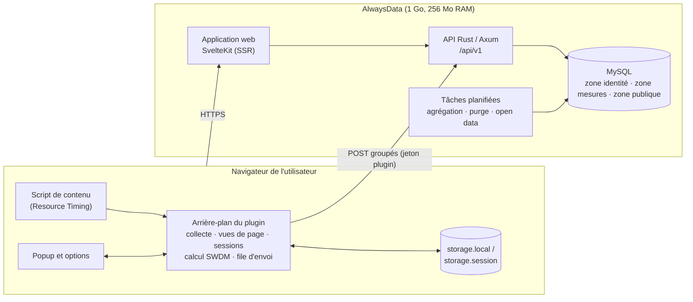
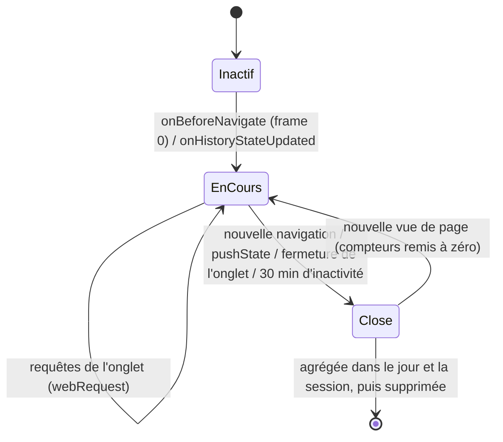
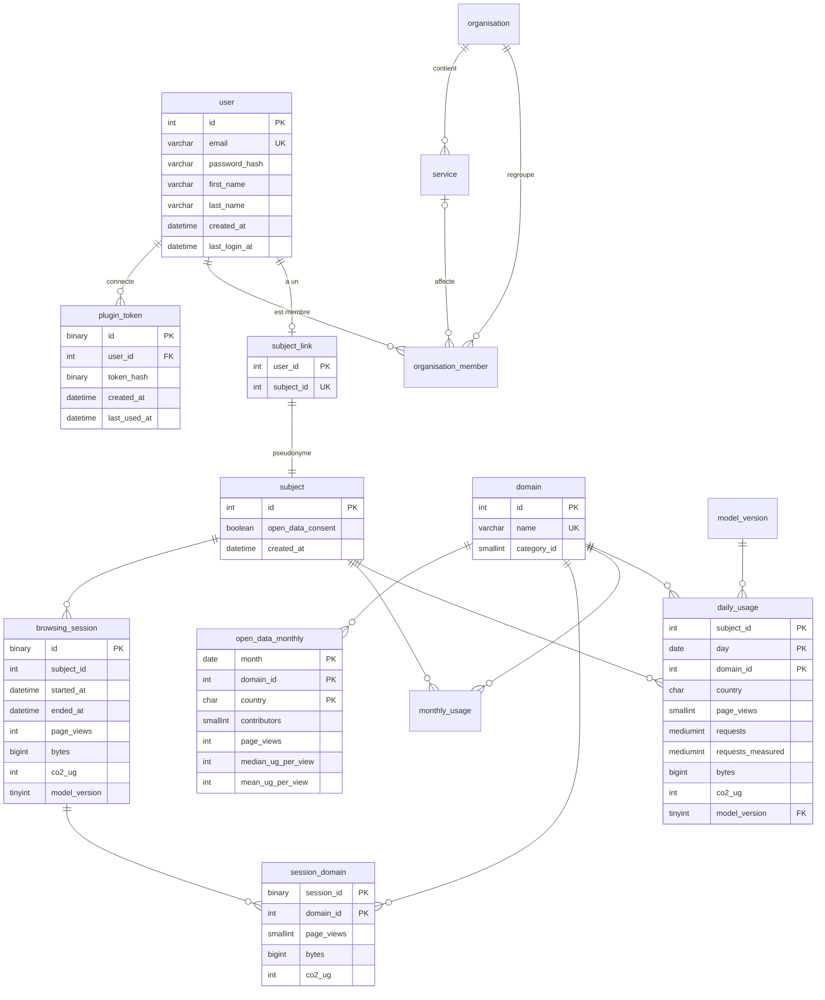

# GreenScore Web — Cahier des charges technique (CDCT)

| | |
|---|---|
| **Version** | 1.0 (projet) — 16 octobre 2026 |
| **Groupe** | N°2 — PIETRERA-FERRANDINI Jeanne, PINSOLLE Romain, RIOUX Baptiste, ROCHE--RODRIGUEZ Killian |
| **Commanditaire** | Philippe ROOSE |
| **Documents liés** | [CDCF v3](CDCF.md) (le **quoi** et le **pourquoi**) · [Méthodologie de calcul](methodologie-calcul.md) (les **formules**) · [ADR](adr/) (les **décisions**) |

> **CDCF ou CDCT ?** Le CDCF exprime le besoin (fonctions, critères, niveaux) **sans parler de technique**. Le CDCT décrit **comment** le système y répond : architecture, code, données, API, sécurité, tests, déploiement. Chaque exigence technique cite l'exigence du CDCF qu'elle sert (EF-…, ENF-…, FC…).
>
> Conventions : **DOIT** = obligatoire ; **DEVRAIT** = recommandé (écart justifié par un ADR) ; **PEUT** = optionnel.

---

## Sommaire

1. [Contexte et contraintes techniques](#1-contexte-et-contraintes-techniques)
2. [Audit technique de l'existant](#2-audit-technique-de-lexistant)
3. [Architecture cible](#3-architecture-cible)
4. [Plugin de navigateur](#4-plugin-de-navigateur)
5. [Module de calcul](#5-module-de-calcul)
6. [Données](#6-données)
7. [API REST](#7-api-rest)
8. [Application web](#8-application-web)
9. [Sécurité](#9-sécurité)
10. [Performance et sobriété](#10-performance-et-sobriété)
11. [Qualité, tests et intégration continue](#11-qualité-tests-et-intégration-continue)
12. [Protocole de validation de la précision](#12-protocole-de-validation-de-la-précision)
13. [Environnements et déploiement](#13-environnements-et-déploiement)
14. [Publication open source](#14-publication-open-source)
15. [Plan de migration v2 → v3](#15-plan-de-migration-v2--v3)
16. [Traçabilité](#16-traçabilité-exigences--composants--preuves)
17. [Décisions d'architecture](#17-décisions-darchitecture-adr)

---

## 1. Contexte et contraintes techniques

| Contrainte | Valeur | Source |
|---|---|---|
| Hébergement | AlwaysData, offre **Free** : **1 Go de disque, base comprise**, 256 Mo de RAM, 1/4 de processeur, usage non lucratif, sites sur le domaine `*.alwaysdata.net` | Documentation AlwaysData (*Public Cloud prices*), 16/10/2026. **L'offre réellement utilisée est à confirmer avec le commanditaire**, car l'offre Free indique aussi qu'elle ne permet pas de faire tourner de « services ». |
| Base de données | MySQL / MariaDB fournie par AlwaysData | Existant |
| Back-end | Rust (édition 2024), Axum 0.8, SQLx 0.8, tower-sessions, bcrypt | `backend/Cargo.toml` |
| Front-end | SvelteKit 2, Svelte 5, Tailwind 4, Chart.js 4, `adapter-node` | `frontend/package.json` |
| Navigateurs | Firefox (Manifest V2 aujourd'hui), Chrome (Manifest V3) | `plugin/*/manifest.json` |
| Licences | Le code existant **n'a pas de licence** ; EcoIndex sous CC BY-NC-ND ; CO2.js sous Apache-2.0 ; données Ember sous CC BY-SA 4.0 | §14 |

---

## 2. Audit technique de l'existant

### 2.1 Méthode

- **Périmètre :** dépôt `green-score-plugin/GreenScorePlugin-Rust-Svelte`, branche par défaut, dernier commit `39e3a99` (16/04/2026). Plugin Firefox et Chrome, API Rust, front-end, schéma SQL, CI. Le dépôt 2024-2025 a été consulté pour l'historique du modèle de calcul : il est identique.
- **Méthode :** lecture du code, comparaison des deux plugins, vérification des API utilisées dans les documentations officielles (MDN, Chrome Developers). Le code **n'a pas encore été exécuté**. Les constats marqués 🔬 sont à confirmer par un test reproductible au Sprint 2. Les autres découlent directement du code.
- **Gravité :**
  - **Critique** : faille ou donnée fausse affichée à tous ;
  - **Majeure** : résultat faux dans des cas fréquents ;
  - **Mineure** : dette technique.

### 2.2 Synthèse

| Domaine | Critique | Majeure | Mineure |
|---|---|---|---|
| Calcul et mesure | 2 | 7 | 1 |
| Sécurité | 3 | 2 | 0 |
| Vie privée | 1 | 2 | 0 |
| Données et stockage | 0 | 3 | 1 |
| Architecture et DX | 0 | 2 | 3 |
| **Total** | **6** | **16** | **5** |

### 2.3 Constats détaillés

#### Calcul et mesure

| ID | Gravité | Localisation | Constat | Correctif v3 |
|---|---|---|---|---|
| A-01 | **Critique** | `plugin/*/background.js` `CARBON_CONSTANTS` (l. 569-571), `calculateCarbonEmissions` (l. 575-577) | Coefficient de 0,15 Wh **par requête**, non sourcé : il représente ≈ 96 % du résultat. Diviser le poids d'une page par 10 ne change le score que de 3,4 % | Modèle SWDM v4 via CO2.js ([méthodologie §3](methodologie-calcul.md#3-le-modèle-v3-proposé), ADR-0001) |
| A-02 | **Critique** | `plugin/chrome/background.js` l. 525 | `details.responseSize` **n'existe pas** dans `chrome.webRequest.onCompleted` (documentation Chrome) → le volume transféré vaut toujours 0 sur Chrome | Règle de mesure commune (§4.4) |
| A-03 | Majeure | `plugin/firefox/src/background.js` l. 529-541 | `Content-Length` (déjà la taille **compressée**) divisé par 3 (gzip) ou 5 (brotli) → volume sous-estimé | Utiliser `Content-Length` tel quel (§4.4) |
| A-04 | Majeure | `onCompleted` (les deux plugins) | `fromCache` est ignoré → les ressources en cache sont comptées comme transférées. Les réponses sans `Content-Length` (*chunked*) comptent pour 0 | §4.4 : cache = 0 octet ; repli Resource Timing ; taux de couverture |
| A-05 | Majeure 🔬 | `getLatestCarbonIntensity` l. 119 ; `calculateCarbonEmissions` l. 580-582 | En cas d'erreur d'API, l'intensité vaut `-1`. Comme `-1 \|\| 442` vaut `-1` en JavaScript, l'**empreinte devient négative** ; elle est envoyée en base et **réduit le total** de l'utilisateur | Intensité annuelle embarquée, pas d'appel réseau (ADR-0005) |
| A-06 | Majeure | `getLatestCarbonIntensity` l. 74 et 107 | L'intensité récupérée est affectée à l'**onglet actif**, pas à l'onglet mesuré | Calcul pur, sans état partagé entre onglets (§5) |
| A-07 | Majeure 🔬 | `webNavigation` l. 380-410 ; `handleUrlChange` | (1) Au début de chaque navigation, une mesure quasi vide est envoyée pour la nouvelle URL : **deux lignes par page**. (2) Sur une application monopage (`onHistoryStateUpdated`), les compteurs ne sont **pas remis à zéro** : chaque changement d'URL renvoie le **cumul**, ce qui fait un **double comptage** | Modèle « vue de page » avec identifiant et remise à zéro (§4.3) |
| A-08 | Majeure | `processAndSendData` l. 279 | Verrou global `sendInProgress` : si deux onglets envoient en même temps, le second envoi est **abandonné sans nouvel essai** | File d'attente persistante et envoi groupé (§4.6) |
| A-09 | Majeure | `backend/src/green_score.rs` l. 43-44, 86 et 135 | Note « page » : seuils fixes de 0,25 g, non sourcés (≠ EcoIndex). Note « profil » : `max = \|min − moy\| × 2`, incohérent. Note « organisation » : compare une **somme** à une **moyenne de moyennes** | Échelle SWDM ; indicateurs normalisés ([méthodologie §3.5 et 3.7](methodologie-calcul.md#35-étape-4--note-de-la-page-échelle-officielle-swdm-v4)) |
| A-10 | Mineure | `calculateCarbonEmissions` l. 596 | `toFixed(2)` : les pages < 0,005 g sont stockées à 0 | Stockage en **microgrammes entiers** (§6) |

#### Sécurité

| ID | Gravité | Localisation | Constat | Correctif v3 |
|---|---|---|---|---|
| S-01 | **Critique** | `backend/src/controllers/plugin_controller.rs` l. 34-38 ; `service/monitored_website_service.rs` | `save_monitored_website_data` **enregistre d'abord** la mesure avec le `user_id` **fourni par le client**, puis vérifie la session. N'importe qui peut écrire dans le compte de n'importe qui, et **même sans être connecté** : l'erreur arrive après l'écriture | Identité issue **uniquement** du jeton ou de la session serveur (§7.2, §9) |
| S-02 | **Critique** | `plugin/firefox/src/config.js` l. 14, `plugin/chrome/config.js` l. 14 | **Clé d'API Electricity Maps en clair** dans le dépôt public et dans l'extension distribuée | **Révocation immédiate** ; plus de clé côté client (ADR-0005) ; détection de secrets en CI |
| S-03 | **Critique** | `db/greenscoreweb_database.sql`, `backend/migrations/*.sql` | L'export de base publié contient des **comptes** (e-mails, apparemment personnels, et mots de passe hachés avec bcrypt) | Purge ; jeu de données de test **synthétique** ; publication sans l'historique (§14) ; information des personnes concernées via le commanditaire |
| S-04 | Majeure | `MonitoredWebsiteService::lpc` l. 66, route `GET /derniere-page-consultee` | Une requête **GET** avec des paramètres **écrit en base** pour l'utilisateur connecté. Comme le cookie est en `SameSite=Lax`, un simple lien piégé peut injecter des mesures dans le compte de la victime (**CSRF**) | Aucune écriture en GET ; écritures en POST avec un jeton |
| S-05 | Majeure | `backend/src/main.rs` l. 28 | Cookie de session avec `with_secure(false)` | `Secure` en production (ENF-SEC-3) |

#### Vie privée

| ID | Gravité | Localisation | Constat | Correctif v3 |
|---|---|---|---|---|
| P-01 | **Critique** | `background.js` l. 326-327 ; table `monitored_website.url_full` | L'**URL complète** de chaque page (chemins, paramètres, parfois des jetons) est envoyée et stockée avec le `user_id` | Domaine enregistrable uniquement ; agrégation quotidienne ; pseudonyme (§6, ADR-0002) |
| P-02 | Majeure | `fetchCountry` l. 437 | L'adresse IP de l'utilisateur est envoyée à **ipwhois.app** (tiers) pour obtenir le pays ; côté serveur, le front-end appelle aussi `restcountries.com` et `flagcdn.com` | Pays choisi par l'utilisateur ; drapeaux embarqués |
| P-03 | Majeure | `plugin/*/popup.js` l. 276 et 325 | Pour un utilisateur non connecté, la page de détail reçoit l'**URL complète en paramètre d'URL** : elle apparaît alors dans l'historique et dans les journaux du serveur | Détail calculé et affiché localement, ou envoyé en POST (EF-PAG-2) |

#### Données et stockage

| ID | Gravité | Localisation | Constat | Correctif v3 |
|---|---|---|---|---|
| D-01 | Majeure | Table `monitored_website` | Une ligne par page vue (≈ 300 o), × 2 avec A-07 → ≈ 22 Mo par utilisateur et par an ; quota saturé à ≈ 27 utilisateurs ([CDCF §8](CDCF.md#8-dimensionnement--le-1-go-suffit-il-)) | Schéma agrégé (§6) |
| D-02 | Majeure | `db/greenscoreweb_database.sql` l. 364 | `ON DELETE SET NULL` sur `monitored_website.user_id` : quand un compte est supprimé, son historique (URL complètes comprises) **reste en base** | Suppression en cascade via la table de correspondance (EF-VIE-5) |
| D-03 | Majeure | `monitored_website_repository.rs` l. 228 et 245 | La « moyenne journalière » est `AVG(carbon_footprint)` groupé par jour, c'est-à-dire une **moyenne par page**, faussée en plus par les lignes quasi vides (A-07) | Indicateurs définis dans la méthodologie §3.7 |
| D-04 | Mineure | Schéma | Deux schémas divergents (`db/*.sql` utilise `service_id` ; la migration utilise `user.organisation_id` **et** `organisation_user`) ; `resources` stocké en `longtext` ; `total_carbon_footprint` dénormalisé | Une seule source : migrations SQLx versionnées |

#### Architecture et expérience développeur (DX)

| ID | Gravité | Localisation | Constat | Correctif v3 |
|---|---|---|---|---|
| X-01 | Majeure | `plugin/firefox` et `plugin/chrome` | **Deux copies** d'environ 800 lignes qui divergent déjà (A-02, A-03) | Base de code unique, deux manifestes (§4.1, ADR-0003) |
| X-02 | Majeure 🔬 | `plugin/chrome/manifest.json` (service worker MV3) | L'état (Maps en mémoire) est **perdu** quand Chrome met le service worker en veille, ce qui entraîne une perte de mesures | État persisté (`storage.session` / `storage.local`, §4.5) |
| X-03 | Mineure | `.github/workflows/deploy.yml` l. 37 | Le paquet déployé contient **tout `node_modules`** (dépendances de développement comprises) → espace disque consommé sur le quota de 1 Go | `npm ci --omit=dev` ; mesure de la taille du paquet |
| X-04 | Mineure | `README.md` | Installation incomplète (chemins erronés, fichiers `.env` non documentés) | README et guide de contribution FR/EN, `.env.example` |
| X-05 | Mineure | `plugin/firefox/manifest.json` | Permissions larges (`webRequestBlocking`, `scripting`, `tabs`, `cookies`, `http://127.0.0.1/index.php`) | Permissions minimales (§4.2) |

### 2.4 Ce que nous conservons

- La **séparation API Rust / front-end SvelteKit** : sobre et adaptée aux 256 Mo de RAM (un binaire Rust consomme quelques dizaines de Mo).
- Le **découpage en couches** du back-end : `controllers`, `service`, `repository`, `dto`, `models`. Il est lisible et facilite les tests.
- Les **tests Rust existants** (16 fichiers dans `backend/tests/`) et la CI de tests avec MySQL.
- L'**internationalisation** (`frontend/src/lib/i18n/fr.json`, `en.json`) et les conseils (`advice`).
- Le **déploiement automatisé** vers AlwaysData par SSH, qui sera durci (§13).

---

## 3. Architecture cible

### 3.1 Vue d'ensemble



**Ce qui change par rapport à la v2 :**
- **Plus aucun appel tiers** depuis le plugin : pas de géolocalisation, pas d'API d'intensité carbone.
- **Calcul déterministe** : les données d'intensité sont embarquées dans le plugin.
- **Envois groupés** au lieu d'un envoi par page.
- **Recalcul côté serveur.**
- **Données agrégées et pseudonymisées.**

### 3.2 Choix technologiques

| Composant | Choix | Statut | Justification |
|---|---|---|---|
| API | Rust + Axum + SQLx | Conservé | Faible empreinte mémoire, performances, déjà maîtrisé par l'existant |
| Application web | SvelteKit + Tailwind | Conservé | Peu de JavaScript côté client, rendu côté serveur |
| Base | MySQL / MariaDB | Conservé | Fournie par l'hébergeur |
| Plugin | **TypeScript**, une base de code, compilation par **esbuild** ou **Vite** vers `dist/firefox` et `dist/chrome`, avec **`webextension-polyfill`** | **Nouveau** (ADR-0003) | Supprime la duplication (X-01) ; typage du module de calcul |
| Modèle de calcul | **CO2.js** (`@tgwf/co2`, Apache-2.0), SWDM v4 | **Nouveau** (ADR-0001) | Modèle public, implémentation de référence testable |
| Domaine enregistrable | Bibliothèque **`tldts`** (licence MIT, *Public Suffix List* embarquée) | **Nouveau** | `exemple.co.uk` et non `co.uk` ; `www.` géré correctement |
| Graphiques | Chart.js (conservé) ; évaluer **uPlot** ou du SVG généré côté serveur | À évaluer (Should) | Poids des pages (ENF-PER-3) |
| Détection de secrets | **Gitleaks** (ou TruffleHog) en CI + *secret scanning* GitHub | **Nouveau** | ENF-SEC-1 |

> **Vérifié (CO2.js 0.19.0) :**
> - `model: "swd", version: 4` utilise exactement les constantes de la méthodologie §3.3 (Go décimal, 494 gCO2e/kWh) ;
> - `rating: true` applique l'échelle A+–F, bornes incluses ;
> - les intensités moyennes Ember couvrent 208 pays (codes alpha-3).
>
> Le module `calc/` implémente lui-même ces constantes (fonction pure, sans dépendance à l'exécution). Il utilise CO2.js **uniquement pour générer les vecteurs de test** : l'écart mesuré est nul.
>
> Limites relevées :
> - l'année de référence des intensités n'est pas publiée par CO2.js ;
> - CO2.js renvoie `NaN` pour un code pays invalide (notre module retombe sur la moyenne mondiale) ;
> - la valeur `WORLD` du jeu Ember (472,94) diffère des 494 retenus par le SWDM v4 (nous suivons le SWDM).

### 3.3 Structure du dépôt (monorepo)

```
Greenscore/
├── backend/               API Rust (Axum, SQLx)
│   ├── migrations/        migrations SQLx versionnées (seule source du schéma)
│   ├── src/
│   │   ├── api/v1/        contrôleurs HTTP (un module par ressource)
│   │   ├── calc/          recalcul SWDM v4 côté serveur (doit passer test-vectors.json)
│   │   ├── domain/        services métier
│   │   ├── repository/    accès aux données
│   │   ├── jobs/          agrégation, purge, open data
│   │   └── auth/          sessions web, jetons du plugin
│   └── tests/
├── frontend/              application web SvelteKit
├── plugin/
│   ├── src/
│   │   ├── background/    collector.ts, pageviews.ts, sessions.ts, sync.ts, store.ts
│   │   ├── content/       resource-timing.ts
│   │   ├── domain.ts      domaine enregistrable (tldts)
│   │   ├── popup/  options/  onboarding/
│   │   └── i18n/
│   ├── manifests/         manifest.firefox.json, manifest.chrome.json
│   └── tests/
├── calc/                  package partagé @greenscore/calc (JS ESM + JSDoc), importé par le plugin
│   ├── src/               swdm.js, rating.js, constants.js, grid-intensity.data.js
│   ├── scripts/           génération des intensités et des vecteurs (CO2.js)
│   ├── test/              tests node:test
│   ├── grid-intensity.json  intensités par pays (Ember, CC BY-SA 4.0), lues aussi par le back-end
│   └── test-vectors.json  vecteurs de référence (générés avec CO2.js)
├── bench/                 banc de test de précision (§12) : corpus, scripts, résultats
├── docs/                  CDCF, CDCT, méthodologie, ADR (FR, puis EN)
└── .github/workflows/     CI (§11), déploiement (§13)
```

---

## 4. Plugin de navigateur

### 4.1 Base de code unique, deux cibles

- **DOIT :** une seule base de code TypeScript, compilée en deux paquets (`dist/firefox`, `dist/chrome`).
- **Manifest V3 pour les deux navigateurs.** Différence principale : arrière-plan `background.scripts` (page d'événements) sur Firefox, `background.service_worker` sur Chrome. Les deux manifestes sont générés à partir d'une base commune.
- L'API `browser.*` (promesses) est utilisée partout, via `webextension-polyfill` sur Chrome.
- **DOIT :** le code supposant qu'une API existe sur les deux navigateurs est vérifié dans la documentation MDN **et** Chrome. L'erreur A-02 venait de cette hypothèse.

### 4.2 Permissions minimales (X-05)

| Permission | Usage | v2 |
|---|---|---|
| `webRequest` (observation, non bloquante) | Compter les requêtes et lire `Content-Length` / `fromCache` | Oui (+ `webRequestBlocking`, retiré) |
| `webNavigation` | Détecter les vues de page, y compris dans les applications monopages | Oui |
| `storage` | État des vues, sessions, file d'envoi, paramètres | Non (retiré en v2) |
| `alarms` | Envoi groupé périodique | Non |
| `host_permissions: <all_urls>` | Observer les requêtes de toutes les pages | Oui |
| Script de contenu sur `<all_urls>` | Lecture de `PerformanceResourceTiming.transferSize` | Non |
| ~~`cookies`~~ | Remplacé par un jeton de plugin (§7.2) | Oui |
| ~~`tabs`~~ | Remplacé par `activeTab` pour le popup | Oui |
| ~~`scripting`~~, ~~`notifications`~~ | Inutiles (la notification d'expiration est affichée dans le popup) | Oui |

### 4.3 Modèle « vue de page » (corrige A-07)



- Chaque vue de page a un identifiant `pv_id` (UUID) et le **domaine enregistrable** de la page principale (`tldts.getDomain`).
- Une requête est rattachée à la vue **en cours** de son onglet (`tabId`) au moment de `onBeforeRequest`. Les requêtes de service workers (`tabId = -1`) sont ignorées et comptées dans un indicateur de couverture global.
- Toute transition (navigation, `pushState`, fermeture) **clôt** la vue en cours, puis en ouvre une nouvelle **avec des compteurs à zéro**.
- À la clôture, la vue est **agrégée** dans l'agrégat `jour × domaine` local et, si une session est en cours, dans l'agrégat `session × domaine`. Le détail par vue n'est jamais envoyé au serveur.
- La dernière vue clôturée est conservée localement pour le popup et la page de détail.

### 4.4 Mesure des octets (corrige A-02, A-03, A-04)

```
Pour chaque requête terminée (webRequest.onCompleted) :
  si fromCache                        → octets = 0 ; mesurée = vrai
  sinon si Content-Length présent      → octets = Content-Length (taille encodée, SANS division)
  sinon                                → mesurée = faux (en attente)
Pour chaque entrée Resource Timing reçue du script de contenu (même URL, même vue) :
  si la requête est en attente et transferSize > 0 → octets = transferSize ; mesurée = vrai
À la clôture de la vue :
  couverture = requêtes mesurées / requêtes totales
  octets_total = Σ octets des requêtes mesurées      (borne basse si couverture < 1)
```

- Les en-têtes de réponse (`Content-Length`) ne comptent pas la taille des **en-têtes HTTP** eux-mêmes. L'écart est mesuré par le banc de test. S'il est significatif, une constante moyenne d'en-têtes par requête, **mesurée et documentée**, PEUT être ajoutée.
- Les requêtes en erreur ou annulées comptent comme requêtes, avec 0 octet.
- **Piste si la couverture reste < 90 % (Firefox uniquement) :** `webRequest.filterResponseData` permet de compter les octets réels, mais avec un coût CPU. À évaluer par le banc de test avant toute adoption.

### 4.5 Persistance de l'état (corrige X-02)

| Donnée | Stockage | Durée |
|---|---|---|
| Vues de page en cours (par onglet) | `storage.session` (en mémoire, survit à la mise en veille du service worker) | Session du navigateur |
| Agrégats jour × domaine non envoyés | `storage.local` | Jusqu'à leur envoi, ou 30 jours en local si la synchronisation est désactivée |
| Session multipage en cours | `storage.local` | Jusqu'à son arrêt |
| Historique local des sessions (utilisateur sans compte) | `storage.local` | 20 dernières sessions |
| Paramètres (pays, synchronisation, langue) | `storage.local` | Permanent |
| Jeton du plugin | `storage.local` | Jusqu'à révocation |

Les écritures sont **regroupées** (au plus une écriture par seconde et par onglet) pour limiter les entrées/sorties.

### 4.6 Synchronisation (corrige A-08, sert ENF-SOB-1)

- Synchronisation **désactivée par défaut** (EF-VIE-4). Elle est activée en connectant le plugin au compte (§7.2).
- Agrégats quotidiens : envoyés par **lot** toutes les 15 minutes (`alarms`) s'il y a des données, et au plus 4 fois par heure.
- Sessions : un envoi à l'arrêt de la session.
- Chaque lot a un identifiant `batch_id` (UUID) : un renvoi après une erreur réseau est **idempotent** (§7.3).
- En cas d'échec : nouvel essai avec délai exponentiel (1 min, 5 min, 15 min, puis toutes les heures). Les lots restent en file dans `storage.local`.
- Volume visé : **≤ 10 requêtes pour 100 pages vues** (contre ≈ 200 en v2).

### 4.7 Popup, options, premier lancement

- **Popup :** note, gCO2e, deux équivalents, taux de couverture, bouton de session (démarrer / arrêter, compteur en direct), lien vers le détail. Pas d'appel réseau à l'ouverture : les équivalents sont **embarqués** et mis à jour avec le plugin. **Cible : affichage en < 300 ms.**
- **Options :** pays (pré-rempli à partir de `Intl.DateTimeFormat().resolvedOptions().timeZone`), langue, synchronisation (on/off), connexion ou déconnexion du compte, export local, effacement local.
- **Premier lancement :** écran d'information (données collectées, stockage local, synchronisation optionnelle), conforme aux règles de Mozilla sur la déclaration de collecte de données.

---

## 5. Module de calcul

> Les formules, constantes et sources sont dans la [méthodologie](methodologie-calcul.md). Cette section décrit leur **implémentation**.

### 5.1 Interfaces

Le module partagé `calc/` est écrit en **JavaScript ESM avec types JSDoc**, et non en TypeScript. Node 20 (version utilisée par l'équipe et la CI) n'exécute pas TypeScript nativement, et ce format reste consommable sans étape de compilation par le plugin TypeScript (via le bundler) et par les outils du banc de test. Les signatures, exprimées ici en notation TypeScript, correspondent aux types JSDoc de `calc/src/swdm.js` et `calc/src/rating.js`.

```ts
// calc/src/swdm.js (types JSDoc)
export interface Measure { bytes: number; country: string /* ISO-3166 alpha-2 */ }
export interface Breakdown {
  operational: { dataCenter: number; network: number; device: number }; // gCO2e
  embodied:    { dataCenter: number; network: number; device: number }; // gCO2e
}
export interface Estimate { gco2e: number; breakdown: Breakdown; rating: Rating; modelVersion: string }
export type Rating = 'A+' | 'A' | 'B' | 'C' | 'D' | 'E' | 'F';
export function estimate(m: Measure): Estimate;           // fonction pure, sans effet de bord
export function rate(gco2ePerPageView: number): Rating;    // échelle officielle SWDM v4
```

```rust
// backend/src/calc/mod.rs
pub struct Measure { pub bytes: u64, pub country: [u8; 2] }
pub fn estimate_ug(m: &Measure, model: ModelVersion) -> u64; // microgrammes de CO2e
pub fn rate(ug_per_page_view: u64) -> Rating;
```

### 5.2 Règles

- **DOIT :** fonctions **pures** et déterministes (pas d'appel réseau, pas d'horloge, pas d'état global).
- **DOIT :** le back-end **recalcule** l'empreinte à partir des octets et du pays reçus. La valeur envoyée par le plugin sert uniquement à l'affichage local.
- **DOIT :** stockage en **microgrammes entiers** (`u64` / `INT UNSIGNED`), pour ne pas perdre de précision (A-10). Arrondi uniquement à l'affichage (2 chiffres significatifs, unité adaptée : mg, g, kg).
- **DOIT :** le plugin et le back-end passent **tous** les cas de `calc/test-vectors.json` (tolérance 10⁻⁹ g). Ces vecteurs sont générés par un script qui utilise CO2.js, et versionnés avec le modèle.
- **Données d'intensité :** fichier `calc/grid-intensity.json` (pays alpha-2 → gCO2e/kWh, source Ember, licence ; `referenceYear` à renseigner). Il est généré depuis CO2.js par `npm run generate:intensity` et copié dans le plugin et dans le back-end à la compilation. L'attribution s'affiche dans la page « Notre méthode ».

### 5.3 Exemple de vecteur de test

```json
{
  "model_version": "swdm4-ember-v1",
  "cases": [
    { "name": "2 Mio, monde",  "bytes": 2097152, "country": null, "expected": { "gco2e": 0.31079792640000004, "rating": "E" } },
    { "name": "2 Mio, France", "bytes": 2097152, "country": "FR", "expected": { "gco2e": 0.17967353954304,    "rating": "C" } },
    { "name": "0 octet",       "bytes": 0,       "country": "FR", "expected": { "gco2e": 0,                   "rating": "A+" } }
  ]
}
```

Extrait simplifié du fichier réel `calc/test-vectors.json` : 13 cas de calcul, avec la répartition par segment, et 16 cas de notation. `country: null` = moyenne mondiale de 494 g/kWh pour tous les segments : 0,002097152 Go × 0,30 kWh/Go × 494 g/kWh ≈ 0,31080 g. Pour la France, l'intensité Ember fournie par CO2.js 0.19.0 est de 44,18 g/kWh.

---

## 6. Données

### 6.1 Principes (ADR-0002)

1. **Trois zones :**
   - **identité** : comptes, organisations, correspondance avec les pseudonymes ;
   - **mesures** : aucune donnée d'identité, seulement un pseudonyme ;
   - **publique** : agrégats k-anonymes.
2. Le **pseudonyme** `subject_id` est un entier **aléatoire** de 32 bits, tiré au hasard avec un contrôle de collision. Il n'est dérivé ni de l'identifiant du compte, ni de l'ordre d'inscription. Les tables de mesures n'ont **aucune clé étrangère** vers `user`.
3. Granularité minimale : **jour × domaine**. Aucune URL, aucune heure précise, sauf le début et la fin d'une session explicitement enregistrée par le membre.
4. Une seule source du schéma : les **migrations SQLx** (`backend/migrations/`), jouées par la CI.

### 6.2 Modèle de données cible



`subject` et `subject_link` peuvent être fusionnés (une seule table `subject_link(user_id, subject_id)`). Ils sont distingués ici pour montrer les deux zones : la zone mesures ne connaît que `subject.id`. Tables techniques non représentées :
- `monthly_usage` : même structure que `daily_usage`, avec `month` à la place de `day` ;
- `ingest_batch(id BINARY(16) PK, subject_id, received_at)` : idempotence des envois ;
- `model_version(id, code, published_at)` ;
- `equivalent(…, source_url, source_date)` ;
- `advice` (existant) ;
- `sessions` (sessions d'authentification, existant).

### 6.3 Extrait du DDL (zone mesures)

```sql
CREATE TABLE domain (
  id           INT UNSIGNED NOT NULL AUTO_INCREMENT,
  name         VARCHAR(253) NOT NULL,           -- domaine enregistrable, minuscules, punycode
  category_id  SMALLINT UNSIGNED NULL,
  PRIMARY KEY (id),
  UNIQUE KEY uk_domain_name (name)
) ENGINE=InnoDB;

CREATE TABLE daily_usage (
  subject_id         INT UNSIGNED      NOT NULL,
  day                DATE              NOT NULL,
  domain_id          INT UNSIGNED      NOT NULL,
  country            CHAR(2)           NOT NULL,
  page_views         SMALLINT UNSIGNED NOT NULL,
  requests           MEDIUMINT UNSIGNED NOT NULL,
  requests_measured  MEDIUMINT UNSIGNED NOT NULL,
  bytes              BIGINT UNSIGNED   NOT NULL,
  co2_ug             INT UNSIGNED      NOT NULL,    -- recalculé par le serveur
  model_version      TINYINT UNSIGNED  NOT NULL,
  PRIMARY KEY (subject_id, day, domain_id),         -- index clustérisé : lecture « mes données »
  KEY idx_day_domain (day, domain_id),              -- agrégations open data et organisation
  CONSTRAINT fk_du_domain FOREIGN KEY (domain_id) REFERENCES domain(id)
) ENGINE=InnoDB;
```

L'insertion se fait en **upsert** (`INSERT … ON DUPLICATE KEY UPDATE page_views = page_views + VALUES(page_views), …`), protégé par l'idempotence des lots (§7.3).

### 6.4 Tâches planifiées (`backend/src/jobs`)

| Tâche | Fréquence | Action |
|---|---|---|
| Purge des sessions d'authentification | Toutes les heures | Existant (`cleanup.rs`) |
| Purge des lots d'idempotence | Quotidienne | Supprimer les `ingest_batch` de plus de 7 jours |
| Agrégation mensuelle | Mensuelle | `daily_usage` de plus de 13 mois → `monthly_usage`, puis suppression |
| Purge des sessions de navigation | Quotidienne | Supprimer les sessions de plus de 13 mois |
| Comptes inactifs | Mensuelle | 23 mois sans connexion : e-mail d'avertissement ; 24 mois : suppression |
| Open data | Mensuelle | Calcul de `open_data_monthly` (k ≥ 10, voir §6.5), test de conformité, export CSV / JSON |
| Supervision du stockage | Quotidienne | Somme `data_length + index_length` de `information_schema.TABLES` ; journal et alerte à 70 % du budget |

Sur AlwaysData, ces tâches sont lancées soit par le **planificateur de tâches** de l'hébergeur (une commande du binaire, ex. `greenscore-api job monthly-rollup`), soit par une boucle `tokio` interne à l'API, comme le fait déjà `cleanup.rs`. Le choix dépend de l'offre (§1).

### 6.5 Open data : requête de référence

```sql
-- Une ligne par domaine × mois × pays, seulement si ≥ 10 pseudonymes distincts
INSERT INTO open_data_monthly (month, domain_id, country, contributors, page_views, mean_ug_per_view, median_ug_per_view)
SELECT :month, d.domain_id, d.country,
       COUNT(DISTINCT d.subject_id),
       SUM(d.page_views),
       SUM(d.co2_ug) / SUM(d.page_views),
       NULL                                   -- médiane calculée en Rust (MySQL n'a pas de fonction médiane native)
FROM daily_usage d
JOIN subject s ON s.id = d.subject_id AND s.open_data_consent = TRUE
WHERE d.day >= :month AND d.day < :month + INTERVAL 1 MONTH
GROUP BY d.domain_id, d.country
HAVING COUNT(DISTINCT d.subject_id) >= 10;
```

Le **test de conformité**, exécuté avant chaque export, vérifie : `MIN(contributors) ≥ 10`, l'absence de toute colonne d'identité, et l'absence de domaines hors dictionnaire.

### 6.6 Dimensionnement

Le calcul détaillé est dans le [CDCF §8](CDCF.md#8-dimensionnement--le-1-go-suffit-il-) : ≈ 100 octets par ligne `daily_usage`, ≈ 0,8 Mo par utilisateur actif la première année, contre ≈ 22 Mo en v2. **Vérification au Sprint 3 :** script `bench/gen-dataset` (1 000 pseudonymes × 365 jours selon les hypothèses du CDCF), puis mesure réelle via `information_schema`.

---

## 7. API REST

### 7.1 Conventions

- Préfixe **`/api/v1`**. JSON en UTF-8. Dates au format ISO 8601. Empreintes en **microgrammes** (`co2_ug`) dans l'API ; conversion à l'affichage.
- Erreurs au format RFC 9457 (`application/problem+json`) : `type`, `title`, `status`, `detail`.
- Les routes actuelles (`/auth/*`, `/account/*`, `/plugin/*`, `/derniere-page-consultee`…) restent disponibles pendant la migration, puis sont **retirées**. `/plugin/save_monitored_website_data` est **désactivée dès le Sprint 2** (S-01).

### 7.2 Authentification

| Client | Mécanisme |
|---|---|
| Application web | Session `tower-sessions` existante ; cookie `Secure; HttpOnly; SameSite=Lax` ; écritures uniquement en POST/PATCH/DELETE, avec un en-tête anti-CSRF (`X-Requested-With`, vérifié avec l'origine) |
| Plugin | **Jeton de plugin** (ADR-0004) : depuis « Mon compte → Connecter le plugin », l'application crée un jeton aléatoire de 256 bits. Il est transmis au plugin par la page de connexion (message vers l'extension), puis stocké dans `storage.local`. Le serveur ne garde que son **empreinte SHA-256**. Le jeton est envoyé en `Authorization: Bearer …`, révocable et listé dans « Mon compte » |

**Règle absolue (S-01, FC7) :** l'identité vient **uniquement** de la session ou du jeton. Tout champ `user_id` ou `subject_id` présent dans le corps d'une requête est **rejeté** (400).

### 7.3 Points d'entrée

| Méthode | Chemin | Auth | Description | Exigences |
|---|---|---|---|---|
| POST | `/api/v1/auth/register`, `/login`, `/logout` | — / session | Existant, déplacé | — |
| POST | `/api/v1/plugin-tokens` | Session | Créer un jeton de plugin | EF-SEC-1 |
| GET / DELETE | `/api/v1/plugin-tokens[/{id}]` | Session | Lister / révoquer les jetons | EF-SEC-1 |
| POST | `/api/v1/usage/daily` | Jeton | Envoi groupé d'agrégats jour × domaine (idempotent) | EF-PRE-2, EF-SEC-3 |
| POST | `/api/v1/sessions` | Jeton | Enregistrer une session (idempotent par `id`) | EF-SES-4 |
| GET | `/api/v1/sessions?from&to&limit&cursor` | Session / jeton | Historique des sessions | EF-SES-5 |
| GET / DELETE | `/api/v1/sessions/{id}` | Session / jeton | Détail par domaine / suppression | EF-SES-5 |
| GET | `/api/v1/me/summary?period=7d\|30d\|12m` | Session | Indicateurs normalisés + note + centile (si ≥ 20 utilisateurs actifs) | EF-PRE-5 |
| GET | `/api/v1/me/timeseries?granularity=day\|week\|month` | Session | Série temporelle | — |
| GET | `/api/v1/me/top-domains?period` | Session | Top 5 des domaines | — |
| GET | `/api/v1/me/export?format=json\|csv` | Session | Export complet + dictionnaire + version du modèle | EF-EXP-1 |
| DELETE | `/api/v1/me` | Session + mot de passe | Suppression du compte et de toutes ses mesures | EF-VIE-5 |
| GET | `/api/v1/organisations/{id}/summary`, `/timeseries`, `/top-domains` | Session (membre administrateur) | Agrégats (seuils de 5 et 10, voir CDCF EF-ORG) | EF-ORG-1, EF-ORG-2 |
| POST / DELETE | `/api/v1/organisations/{id}/members…` | Session (administrateur, **vérifié par le serveur**) | Gestion des membres et des services | EF-ORG-3 |
| GET | `/api/v1/open-data/monthly?month&country` | Public (mis en cache) | Agrégats k-anonymes | EF-ODA-1 |
| GET | `/api/v1/methodology` | Public | Versions du modèle, constantes, sources (JSON) | EF-PRE-4 |
| GET | `/api/v1/equivalents`, `/api/v1/advice` | Public | Équivalents sourcés, conseils | EF-PAG-1 |

### 7.4 Exemple : envoi groupé

```http
POST /api/v1/usage/daily
Authorization: Bearer <jeton du plugin>
Content-Type: application/json

{
  "batch_id": "6f1c1b7e-5c3a-4b0e-9a57-2c8f7f9b1e21",
  "model_version": "swdm4-ember-v1",
  "country": "FR",
  "days": [
    { "day": "2026-10-16",
      "domains": [
        { "domain": "exemple.fr", "page_views": 12, "requests": 640, "requests_measured": 611, "bytes": 18734211 },
        { "domain": "wikipedia.org", "page_views": 5, "requests": 210, "requests_measured": 210, "bytes": 3120044 }
      ] }
  ]
}
```

Réponses :
- `202 Accepted` : `{ "batch_id": "…", "accepted_rows": 2 }` ;
- `200 OK` si le `batch_id` a déjà été traité (pas de double comptage) ;
- `400` en cas de validation échouée ;
- `401` si le jeton est absent ou révoqué ;
- `429` en cas de limite atteinte.

**Validation côté serveur (EF-SEC-3) :**
- `day` compris entre J−30 et J+1 ;
- `domain` valide selon la *Public Suffix List* (≤ 253 caractères) ;
- `0 ≤ requests_measured ≤ requests ≤ 100 000` par ligne ;
- `bytes ≤ 50 Go` par ligne ;
- `page_views ≤ 5 000` par ligne ;
- `country` dans la table des pays ;
- `model_version` connue ;
- au plus 500 lignes par lot.

**Limitation de débit :** 60 requêtes par minute et par jeton.

---

## 8. Application web

| Page | Changement |
|---|---|
| Accueil | Explication du modèle, lien vers « Notre méthode » |
| **Notre méthode** (nouvelle) | Rendu de la méthodologie : constantes, sources, limites, versions du modèle, attributions (Ember, SWDM, CO2.js) |
| Dernière page consultée | Alimentée par le plugin (message vers l'extension ou POST), **plus par des paramètres d'URL**. Répartition data center / réseau / terminal, fonctionnement / fabrication, taux de couverture |
| Mes données | Indicateurs normalisés par période, note SWDM, centile, top 5, séries temporelles |
| **Mes sessions** (nouvelle) | Liste, détail par domaine, **comparaison de deux sessions** |
| Mon organisation | Agrégats avec seuils ; message explicatif quand un seuil n'est pas atteint |
| Mon compte | Jetons du plugin, export, suppression du compte, consentement open data |
| **Données ouvertes** (nouvelle) | Visualisations et téléchargements (CSV / JSON + dictionnaire + licence) |
| Confidentialité | Mise à jour (CDCF §7) |

Exigences transverses :
- poids de page ≤ 0,079 g selon notre propre outil (note A, ENF-PER-3) ;
- pas de dépendance à des services tiers au chargement (drapeaux embarqués, polices locales) ;
- accessibilité RGAA de niveau A sur ces pages (ENF-ACC-1) ;
- FR / EN.

---

## 9. Sécurité

### 9.1 Analyse des menaces (STRIDE simplifiée)

| Menace | Exemple dans GreenScore | Mesure |
|---|---|---|
| **Usurpation** | Écrire des mesures au nom d'un autre (S-01) | Identité issue uniquement de la session ou du jeton ; jetons stockés hachés ; révocation |
| **Falsification** | Envoyer des gCO2e absurdes ou négatifs | Recalcul serveur ; bornes de validation ; limitation de débit |
| **Répudiation** | Contester une action d'administration d'organisation | Journal des actions d'administration (qui, quoi, quand), sans données de navigation |
| **Divulgation** | URL complètes, export SQL publié (P-01, S-03) | Minimisation ; pseudonymisation ; jeux de test synthétiques ; détection de secrets |
| **Déni de service** | Lots massifs, saturation du disque de 1 Go | Taille de lot limitée ; limitation de débit ; supervision du stockage |
| **Élévation de privilèges** | Un membre appelle des routes d'administration d'organisation | Vérification serveur du rôle à chaque requête ; tests d'autorisation automatisés |

### 9.2 Exigences

- **DOIT :** révoquer la clé Electricity Maps exposée (S-02) et demander au commanditaire de **retirer ou purger** les données personnelles du dépôt 2025-2026 (S-03).
- **DOIT :** gérer les secrets uniquement par variables d'environnement (`.env`, non versionné, avec un `.env.example` documenté) et par les *secrets* GitHub Actions.
- **DOIT :** bcrypt (existant) ou Argon2id pour les mots de passe ; limitation des tentatives de connexion (5 par minute et par adresse IP, en mémoire).
- **DOIT :** cookies `Secure; HttpOnly; SameSite=Lax` ; CORS limité à l'origine de l'application (le plugin utilise le jeton, pas le CORS avec cookies).
- **DOIT :** en CI, `cargo audit`, `npm audit --audit-level=high`, Gitleaks, et `web-ext lint` pour le plugin.
- **DEVRAIT :** en-têtes de sécurité HTTP : `Content-Security-Policy`, `Referrer-Policy: no-referrer`, `X-Content-Type-Options`.

---

## 10. Performance et sobriété

| Indicateur | Outil / méthode | Référence v2 | Cible v3 |
|---|---|---|---|
| Requêtes émises par le plugin / 100 pages | Compteur interne du plugin + moniteur réseau | ≈ 200 + appels tiers (à mesurer) | ≤ 10, 0 tiers |
| Surcoût sur le chargement des pages | 10 chargements avec et sans plugin (Playwright), test statistique | À mesurer | Non significatif (< 2 %) |
| Mémoire du plugin | `about:processes` (Firefox), gestionnaire de tâches (Chrome), après 100 pages | À mesurer | ≤ référence v2 |
| Temps d'affichage du popup | Marqueurs `performance.now()` | À mesurer | < 300 ms |
| Temps de réponse de l'API (95ᵉ centile) | `oha` (MIT), 10 requêtes/s pendant 60 s, sur l'hébergement réel | À mesurer | < 300 ms |
| Mémoire de l'API | Mémoire résidente pendant le test de charge | À mesurer | < 64 Mo |
| Taille du paquet déployé | `du -sh` sur le paquet | Contient tout `node_modules` (X-03) | −50 % minimum |
| Poids et note de nos pages | Notre plugin + Website Carbon Calculator | À mesurer | Note A |

Toutes les mesures de référence sont faites au **Sprint 2**, consignées dans `bench/results/baseline-v2.md`, puis refaites à chaque jalon.

---

## 11. Qualité, tests et intégration continue

### 11.1 Stratégie de tests

| Niveau | Cible | Outils | Exemples |
|---|---|---|---|
| Unitaire (calcul) | `calc/src`, `backend/src/calc` | `node:test` (en place : 45 tests), `cargo test` | Vecteurs de référence ; échelle de notes (bornes exactes 0,040 / 0,079…) ; domaine enregistrable (`a.b.exemple.co.uk` → `exemple.co.uk`) |
| Unitaire (collecte) | `collector.ts`, `pageviews.ts` | Vitest + faux événements `webRequest` | Cache = 0 ; `Content-Length` sans division ; navigation SPA : pas de double comptage ; deux onglets en parallèle : rien n'est perdu |
| Intégration (API) | Contrôleurs + MySQL | `cargo test` + service MySQL en CI (existant) | Rejet d'un `user_id` dans le corps (S-01) ; idempotence de `batch_id` ; seuils d'organisation ; k-anonymat de l'open data ; suppression du compte en cascade |
| Bout en bout | Plugin chargé dans un vrai navigateur | Playwright (Chromium, extension chargée) ; `web-ext` + Selenium (Firefox) | Session de 10 pages = somme des pages ; survie à la mise en veille du service worker |
| Précision | Banc de test (§12) | Scripts `bench/` | O1 à O5 |
| Non-régression visuelle et accessibilité | Pages principales | Playwright + axe-core | ENF-ACC-1 |

**Couverture :** ≥ 90 % pour les modules de calcul, ≥ 70 % pour l'API (ENF-QUA).

### 11.2 Intégration continue (GitHub Actions)

| Workflow | Déclencheur | Étapes |
|---|---|---|
| `ci.yml` | Chaque PR et `main` | `cargo fmt --check`, `cargo clippy -D warnings`, `cargo test` (MySQL), `npm ci` puis `lint`, `svelte-check` et `test` (front et plugin), vecteurs de calcul (Rust **et** TypeScript), compilation du plugin pour les deux cibles, `web-ext lint` |
| `security.yml` | Chaque PR + hebdomadaire | Gitleaks, `cargo audit`, `npm audit` |
| `deploy.yml` | Étiquette `v*` sur `main` | Compilation release, `npm ci --omit=dev`, envoi SSH vers AlwaysData, migrations SQLx, redémarrage, test de fumée (`GET /api/v1/methodology` = 200) |
| `plugin-release.yml` | Étiquette `plugin-v*` | Paquets signés pour addons.mozilla.org et le Chrome Web Store (publication manuelle validée) |

### 11.3 Conventions

- **Branches :** `main` protégée ; `feat/GS-<n>-<slug>`, `fix/…`, `docs/…`. Les références `GS-<n>` (ou `PROJETGREE-<n>` dans Plane) relient le code au backlog.
- **Commits :** gitmoji, déjà utilisé par l'équipe précédente (`:sparkles:`, `:bug:`, `:memo:`…), avec la référence de la tâche.
- **PR :** au moins une approbation, CI verte, description qui cite l'exigence (EF-… / ENF-…) et, si besoin, l'indicateur mesuré.
- **Rust :** `rustfmt`, `clippy`. **TypeScript / Svelte :** ESLint + Prettier, `strict: true`.

---

## 12. Protocole de validation de la précision

### 12.1 Corpus

- **30 pages publiques**, figées par leur URL et leur date de capture :
  - 10 **sobres** (ex. pages de texte) ;
  - 10 **moyennes** (presse, e-commerce) ;
  - 10 **lourdes** (vidéo, applications monopages).
- **Page de démonstration** hébergée par l'équipe, en deux versions :
  - **v-avant** : images non optimisées, scripts lourds ;
  - **v-après** : images compressées, chargement différé.
  
  Comme nous contrôlons cette page, elle reste stable dans le temps.
- La liste est versionnée dans `bench/corpus.json`. Une page instable (contenu changeant d'un passage à l'autre) est remplacée et la raison est notée.

### 12.2 Vérité terrain

- Pour chaque page et chaque navigateur : export **HAR**, obtenu par l'outil réseau du navigateur ou par l'enregistrement HAR de Playwright. On utilise la somme des **tailles transférées** des réponses.
- **À valider au Sprint 2 :** quels champs HAR donnent la taille transférée sur chaque navigateur, et si les en-têtes y sont inclus. Le protocole sera ajusté en conséquence et documenté.

### 12.3 Déroulé

Pour chaque version (v2, puis v3), chaque navigateur (Firefox, Chrome) et chaque page :
1. Profil de navigateur neuf, **cache désactivé**, plugin installé, pays = FR.
2. Chargement de la page, puis attente de la fin de l'activité réseau (aucune requête pendant 5 s).
3. Récupération de la mesure du plugin (octets, requêtes, couverture, gCO2e) via une page de test interne au plugin, et de l'export HAR.
4. Cinq passages, puis cinq passages **avec cache**.
5. Calcul automatique des indicateurs.

### 12.4 Indicateurs et critères de réussite

| Indicateur | Formule | Critère v3 |
|---|---|---|
| Erreur sur les octets | \|octets_plugin − octets_HAR\| ÷ octets_HAR | Médiane < 5 %, P90 < 15 % (O1) |
| Écart entre navigateurs | \|Firefox − Chrome\| ÷ moyenne | < 10 % (O2) |
| Reproductibilité | écart-type ÷ moyenne sur 5 passages | < 10 % (O3) |
| Conformité du calcul | Vecteurs de test | Écart nul (O4) |
| Sensibilité au poids | gCO2e(v-après) ÷ gCO2e(v-avant) comparé au rapport des octets | Proportionnel, ±5 % (O5) |
| Couverture | Requêtes mesurées ÷ requêtes totales | ≥ 90 % en moyenne |
| Cohérence externe | Rapport GreenScore ÷ Website Carbon Calculator (même modèle) | Même ordre de grandeur. Les écarts sont analysés (cache, pays, hébergement vert) et ne servent **pas** de critère d'échec |

Les résultats sont publiés dans `bench/results/<version>-<date>.md`, avec les données brutes (CSV). Le tableau avant / après en est extrait pour les revues (CDCF §9).

---

## 13. Environnements et déploiement

| Environnement | Où | Données | Usage |
|---|---|---|---|
| Local | Poste du développeur : MySQL via Docker (`docker compose up`), API, front-end, plugin chargé temporairement | Jeu **synthétique** (`backend/seeds/`) | Développement |
| CI | GitHub Actions | Synthétique | Tests |
| Production | `greenscore.alwaysdata.net` | Réelles | Utilisateurs |

- **Sauvegardes :** l'offre Free conserve 3 jours de sauvegardes glissantes. Nous ajoutons un **export chiffré mensuel** de la base, conservé par le commanditaire.
- **Migrations :** `sqlx migrate run` au déploiement ; chaque migration est testée en CI sur une base vide **et** sur une copie anonymisée du schéma v2.
- **Paquet front-end :** `npm ci --omit=dev` (X-03). La taille du paquet est journalisée à chaque déploiement.

---

## 14. Publication open source

| Point | Constat | Action |
|---|---|---|
| **Licence du code existant** | Aucun fichier `LICENSE` dans les dépôts 2024-2025 et 2025-2026. Sans licence, le code reste soumis au **droit d'auteur** de ses auteurs (une dizaine de contributeurs identifiés dans l'historique Git) | Obtenir l'**accord écrit** des auteurs précédents et vérifier le règlement de l'IUT sur les travaux d'étudiants **avant** toute publication sous licence libre. À piloter par le commanditaire |
| **Choix de licence** | À décider (EF-OSS-1) | **AGPL-3.0** si l'on veut que les versions hébergées modifiées restent ouvertes ; **Apache-2.0** ou **MIT** pour maximiser la réutilisation. Les deux sont compatibles avec CO2.js (Apache-2.0). Décision tracée dans un ADR |
| **Données tierces** | Intensités Ember (CC BY-SA 4.0) ; Public Suffix List (MPL-2.0) | Attributions dans « Notre méthode » et `NOTICE` |
| **EcoIndex** | Algorithme et résultats sous CC BY-NC-ND 2.0 FR | Non intégré sans autorisation (ADR-0001) |
| **Licence de l'open data** | Données dérivées d'intensités sous CC BY-SA | Licence de nos données à choisir **en cohérence** (ODbL ou CC BY-SA). À vérifier |
| **Historique** | Les dépôts précédents contiennent une clé d'API et des données personnelles | Le nouveau dépôt part **sans l'historique** : import d'un instantané nettoyé, en citant l'origine dans le README |
| **Documentation** | Partielle, en français | README, CONTRIBUTING, SECURITY (signalement des vulnérabilités), méthodologie : **FR + EN** |

---

## 15. Plan de migration v2 → v3

1. **Sprint 2, immédiatement :**
   - désactiver `/plugin/save_monitored_website_data` sans authentification (S-01) ;
   - révoquer la clé (S-02) ;
   - passer le cookie en `Secure` (S-05) ;
   - publier un correctif du plugin qui **cesse d'envoyer `url_full`** (P-01).
2. **Sauvegarde** complète de la base de production, avant toute migration.
3. **Migration du schéma** (migration SQLx) : création des nouvelles tables (§6.2).
4. **Migration des données :**
   - les lignes dont `user_id` est NULL (comptes supprimés, D-02) sont **supprimées** ;
   - pour chaque utilisateur, on crée le pseudonyme, puis on agrège `monitored_website` par **jour × domaine enregistrable**. Comme les octets v2 sont faux (A-02, A-03), ces lignes sont marquées `model_version = legacy-v2`, affichées comme « ancienne méthode » et **exclues** des comparaisons et de l'open data ;
   - la colonne `url_full` n'est pas reprise.
5. **Vérification :** comptages avant / après, totaux par utilisateur, taille des tables.
6. **Suppression** de `monitored_website` et de `total_carbon_footprint` après une période d'observation (1 sprint).
7. **Publication du plugin v3** sur les deux boutiques. L'ancienne version continue d'envoyer vers l'ancienne route jusqu'à sa mise à jour automatique : la route est maintenue mais **rejette** les écritures non authentifiées.

---

## 16. Traçabilité exigences → composants → preuves

| Exigence (CDCF) | Composants | Preuve |
|---|---|---|
| EF-PRE-1, O1, O2 | `plugin/src/background/collector.ts`, script de contenu | Tests unitaires de collecte ; banc de test §12 |
| EF-PRE-2, O4 | `calc/src`, `backend/src/calc`, `calc/test-vectors.json` | Vecteurs de test en CI (`.github/workflows/calc.yml`) |
| EF-PRE-3, O3 | Calcul pur, intensité embarquée | Banc de test (5 passages) |
| EF-PRE-4 | Page « Notre méthode », `GET /api/v1/methodology` | Revue ; lien depuis le popup |
| EF-PRE-5 | `backend/src/domain/summary.rs` | Tests d'intégration (centile, seuil de 20) |
| EF-SES-1 à 3, 6 | `plugin/src/background/sessions.ts`, `store.ts` | Test de bout en bout « 10 pages » ; test de mise en veille |
| EF-SES-4 et 5 | `POST/GET /api/v1/sessions`, page « Mes sessions » | Tests d'idempotence ; recette |
| EF-VIE-1 et 2, O6 | Schéma §6, `tldts` | Test automatique « aucune colonne d'URL ou d'identité dans la zone mesures » |
| EF-VIE-3 | Options du plugin | Moniteur réseau : 0 appel tiers |
| EF-VIE-5 | `DELETE /api/v1/me` | Test d'intégration de suppression en cascade |
| EF-ODA-1, ENF-VIE-2 | Tâche open data | Test de k-anonymat bloquant |
| EF-ORG-1 et 2 | `GET /api/v1/organisations/*` | Tests des seuils de 5 et 10 |
| EF-SEC-1 à 3, O9 | `auth/`, validation, limitation de débit, CI sécurité | Tests d'autorisation ; Gitleaks |
| ENF-CAP-1, O7 | Schéma agrégé, tâches de purge | `bench/gen-dataset` + `information_schema` |
| ENF-SOB-1, O8 | `sync.ts` | Compteur de requêtes |
| EF-OSS-1 à 3 | LICENSE, README FR/EN, dépôt sans historique | Revue avant publication |

---

## 17. Décisions d'architecture (ADR)

| ADR | Titre | Statut |
|---|---|---|
| [0001](adr/0001-modele-de-calcul-swdm-v4.md) | Modèle de calcul : SWDM v4 via CO2.js, EcoIndex non intégré | Proposé |
| [0002](adr/0002-donnees-agregees-pseudonymisees.md) | Données agrégées par jour × domaine et pseudonymisées | Proposé |
| [0003](adr/0003-plugin-base-de-code-unique-mv3.md) | Plugin : base de code unique TypeScript, Manifest V3 | Proposé |
| [0004](adr/0004-authentification-plugin-par-jeton.md) | Authentification du plugin par jeton révocable | Proposé |
| [0005](adr/0005-intensite-carbone-embarquee.md) | Intensité carbone annuelle embarquée, pays choisi par l'utilisateur | Proposé |

Les ADR passent au statut « Accepté » après validation en revue de sprint avec le commanditaire.
